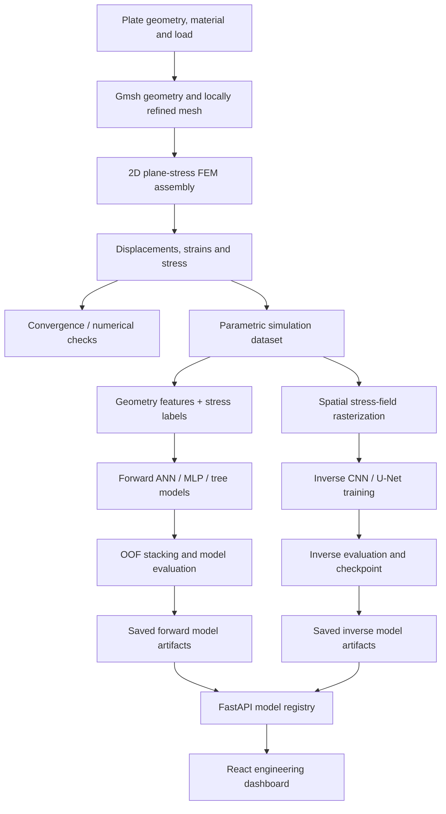
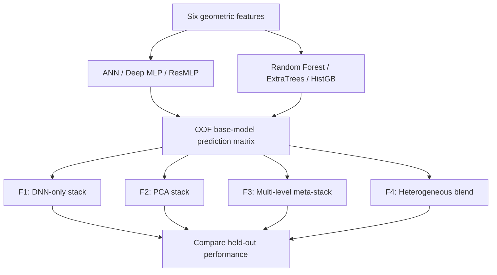
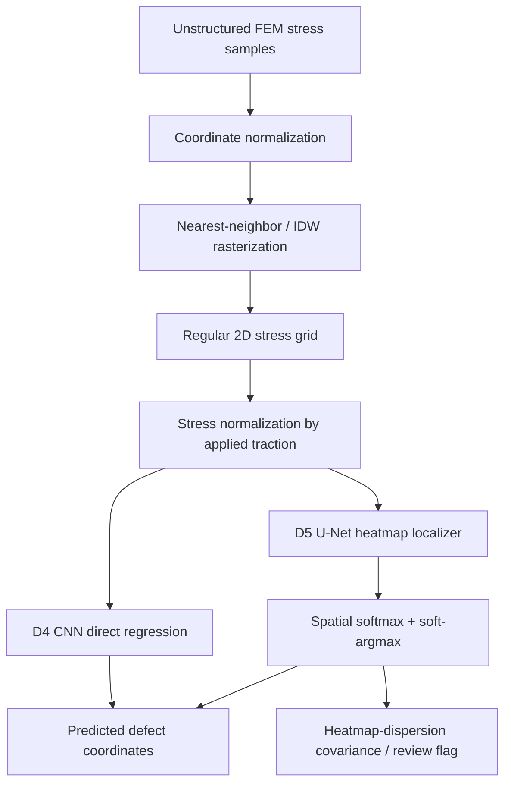
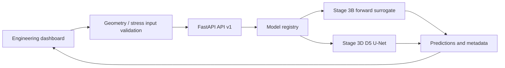

<div align="center">

# SimuStruct

### Physics-Based Finite Element Analysis and Machine Learning for Stress Prediction and Defect Localization

**A computational mechanics research platform combining a custom 2D FEM solver, simulation-driven surrogate models, and spatial deep learning for inverse identification of defects in perforated plates.**

[](https://www.python.org/)
[](#5-finite-element-formulation)
[](#8-machine-learning-methods)
[](#10-web-application-and-api)
[](#10-web-application-and-api)

**[Scientific motivation](#1-scientific-motivation) · [End-to-end workflow](#3-end-to-end-workflow) · [Results](#9-experimental-results) · [Run locally](#11-getting-started) · [Reference paper](#16-research-reference-and-attribution)**

</div>

---

> [!IMPORTANT]
> **Research scope.** SimuStruct is a simulation-based research prototype, not a certified structural design, damage assessment, or industrial inspection tool. Quantitative ML results below are **reported in this repository's experiment documents**; model artifacts and large datasets are not included in the public Git checkout, so the numbers are not independently reproduced by cloning this repository alone.

## At a glance

| Research component | What it does | Engineering significance |
|---|---|---|
| **Finite element solver** | Solves 2D linear-elastic plane-stress problems for plates containing circular holes | Establishes the physics-based simulation foundation |
| **Parametric simulation** | Varies plate geometry, defect size, and defect location | Produces labeled examples without fabricating physical specimens |
| **Forward surrogate** | Estimates the maximum element-centroid Von Mises stress from geometric features | Enables rapid exploration of configurations within the modeled domain |
| **Inverse localization** | Estimates defect-center coordinates from a spatial stress field | Investigates whether stress patterns can reveal hidden defect locations |
| **Scientific verification** | Includes mesh convergence and force-equilibrium checks | Helps assess numerical consistency before ML training |
| **Interactive application** | Provides model-assisted analyses through FastAPI and React | Makes trained surrogate inference accessible through a user interface |

**In one sentence:** We solve a mechanical problem repeatedly with FEM, learn the relationship between geometry and stress, and then use those learned patterns to predict stress or estimate a defect's position without running a fresh full FEM solve for every application request.

### Reported research highlights

| Highlight | Repository-reported value | Qualification |
|---|---:|---|
| Stage 3B dataset | **51,625** simulation records | Includes 50,375 initial cases and 1,250 enrichment cases |
| Plate families | **5** | Heights of 600, 700, 800, 900, and 1000 mm at 1000 mm width |
| Best historical forward ensemble | **F3 multi-level stack** | $R^2=0.9340$, RMSE **2.65 psi** on 7,557 held-out cases |
| F3 blind confirmatory evaluation | **$R^2=0.9634$** | RMSE **4.69 psi** on a separate 500-case set |
| Production default forward framework | **F4 heterogeneous blend** | Separate from the F3 research winner; see [deployment caveats](#14-reproducibility-and-known-caveats) |
| Inverse D5 localizer | **8.43 mm** mean localization error | Five-seed value recorded in the model registry; not independently rerun here |

Sources: [Stage 3B data audit](stage3B_phaseA_model_and_methodology_audit.md), [final forward study](stage3B_final_forward_ensemble_report.md), [confirmatory evaluation](stage3B_confirmatory_evaluation_report.md), and [inverse model registry](backend/app/services/registry.py).

---

## Contents

1. [Scientific motivation](#1-scientific-motivation)
2. [Research questions and contributions](#2-research-questions-and-contributions)
3. [End-to-end workflow](#3-end-to-end-workflow)
4. [Problem definition and geometry](#4-problem-definition-and-geometry)
5. [Finite element formulation](#5-finite-element-formulation)
6. [Numerical verification](#6-numerical-verification)
7. [Dataset generation and feature engineering](#7-dataset-generation-and-feature-engineering)
8. [Machine learning methods](#8-machine-learning-methods)
9. [Experimental results](#9-experimental-results)
10. [Web application and API](#10-web-application-and-api)
11. [Getting started](#11-getting-started)
12. [Project structure](#12-project-structure)
13. [Validation and testing](#13-validation-and-testing)
14. [Reproducibility and known caveats](#14-reproducibility-and-known-caveats)
15. [Limitations and future work](#15-limitations-and-future-work)
16. [Research reference and attribution](#16-research-reference-and-attribution)
17. [Explaining the project to a mechanical engineering audience](#17-explaining-the-project-to-a-mechanical-engineering-audience)

---

## 1. Scientific motivation

Structural plates frequently contain holes for fasteners, assembly, access, or weight reduction. These discontinuities redirect internal loads and may create local stress concentrations. A second, unintended void or defect can further alter stress distribution, especially when it approaches a primary hole and reduces the available **ligament**, the material separating the hole boundaries.

Traditional numerical techniques such as the **Finite Element Method (FEM)** are well suited to this problem. However, a parametric investigation involving thousands of defect positions, sizes, and plate geometries requires repeated geometry construction, meshing, stiffness assembly, linear-system solution, and stress post-processing.

SimuStruct investigates whether a data-driven approximation can complement this physics-based workflow:

- **Forward analysis:** Given the plate and defect configuration, predict its maximum equivalent stress.
- **Inverse analysis:** Given a spatial stress distribution, estimate the center of the unknown defect.

The project is motivated by **[Singh and Pamnani (2025)](#16-research-reference-and-attribution)**, which studied ANN and stacked ensembles for defective plates using Abaqus-generated data. The present repository implements a custom Python FEM solver, extends the forward research to multiple plate aspect ratios and physically informed features, investigates more diverse regressors, and explores **spatial CNN/U-Net-based** inverse localization.

### Practical use cases under investigation

- Rapid screening of candidate defect locations and dimensions.
- Interactive exploration of stress concentration trends.
- Sensitivity studies over a restricted family of plate geometries.
- Research into stress-field-driven localization of hidden circular defects.
- Teaching and demonstration of how numerical mechanics and ML can be connected.

> **What this is not:** The repository does not establish experimental defect detection accuracy on real equipment, crack-growth prediction, fatigue life, yielding or failure probability, multi-defect reconstruction, or validated applicability to arbitrary materials and boundary conditions.

## 2. Research questions and contributions

### Research questions

1. Can an independently implemented 2D plane-stress FEM solver generate mechanically consistent stress responses for perforated plates?
2. How does maximum Von Mises stress vary as defect location, diameter, ligament clearance, and plate aspect ratio change?
3. Can neural and tree-based regressors approximate maximum stress efficiently from a small set of physically meaningful features?
4. Do stacked ensembles improve held-out performance over their constituent base estimators?
5. Does supplying the **spatial stress field**, rather than a single maximum-stress scalar, provide a useful representation for inverse defect localization?
6. How do these methods behave on narrow-ligament and out-of-training-domain cases?

### Implemented and documented contributions

**C1. Custom FEM foundation.** The repository implements Gmsh-generated 2D triangular meshes, linear-elastic plane-stress constitutive behavior, sparse global stiffness assembly, force application, boundary constraints, displacement solution, and stress recovery. See [`src/geometry.py`](src/geometry.py) and [`src/fem_solver.py`](src/fem_solver.py).

**C2. Numerical consistency checks.** A five-tier mesh-convergence workflow compares peak stress, displacement, and strain energy, alongside support-reaction equilibrium quantities. See [`src/convergence.py`](src/convergence.py).

**C3. Multi-geometry simulation dataset.** The Stage 3B reports describe 51,625 labeled FEM records spanning five rectangular/square plate families and varied circular defects.

**C4. Physics-informed forward surrogate.** Six normalized geometric features feed neural networks, tree ensembles, and stacked regressors for maximum element-centroid stress prediction.

**C5. Spatial inverse model.** Unstructured FEM stresses are interpolated onto a regular grid; a CNN regression baseline and a U-Net heatmap approach are implemented for defect-center estimation. See [`src/stage3D_rasterizer.py`](src/stage3D_rasterizer.py) and [`src/stage3D_cnn_unet.py`](src/stage3D_cnn_unet.py).

**C6. Application layer.** The repository includes a FastAPI model service, request validation, model metadata, and a React/TypeScript engineering interface.

These are repository-supported implementation/research claims, not a claim of formal novelty over all existing literature.

## 3. End-to-end workflow

The system has **two distinct operating phases**:

- **Offline research:** FEM simulations, dataset generation, model fitting, and testing.
- **Online inference:** A user submits supported inputs; the API loads previously trained models and returns predictions. The normal forward endpoint does **not** execute a new full FEM solve.



### Why each stage exists

| Stage | Why it is required |
|---|---|
| Geometry definition | Ensures the physical configuration is unambiguous and valid |
| Meshing | Converts the continuous plate into numerical elements |
| Constitutive model | Relates strain to stress under assumed material behavior |
| FEM solution | Produces physically grounded displacement and stress information |
| Verification | Checks numerical consistency before simulation results become ML labels |
| Parametric sweeps | Exposes the model to changes in geometry and defect characteristics |
| Feature design | Encodes relationships important for stress concentration |
| Train/validation/test split | Separates learning from assessment of generalization |
| Stacked learning | Tests whether combining complementary estimators improves prediction |
| Stress-field rasterization | Makes irregular FEM fields compatible with convolutional models |
| U-Net localization | Uses spatial stress patterns to infer defect-center coordinates |
| Model-serving API | Reuses trained checkpoints for repeated predictions |

## 4. Problem definition and geometry

### 4.1 Mechanical configuration

The numerical model represents a rectangular isotropic plate with:

- A known central circular hole.
- An additional smaller circular hole used as the defect.
- A tensile traction on the top edge.
- Vertical displacement constrained at the bottom edge and one horizontal pin to remove rigid-body translation.
- Traction-free lateral sides and hole boundaries.

A conceptual plan view is shown below (not to scale):

```text
                   Applied tensile traction (sigma_0)
                      ^  ^  ^  ^  ^  ^
       y = H    +-----------------------------------+
                |                                   |
                |        o  smaller defect          |
                |                                   |
                |              O                    |
                |         known central hole        |
                |                                   |
                |                                   |
       y = 0    +-----------------------------------+
                ^  ^  ^  ^  ^  ^  ^  ^  ^  ^  ^
                  u_y = 0 along the bottom
                     one bottom u_x pin

                <------------ L ---------------->
```

Here, $L$ denotes plate width along the horizontal $x$ direction and $H$ denotes plate height along the tensile $y$ direction in the **Stage 3B/production** geometry convention. The standalone normalized solver uses its own configuration field names (`plate_width` along $x$, `plate_length` along $y`).

### 4.2 Reference-paper / standalone FEM baseline

| Quantity | Value |
|---|---:|
| Plate | Normalized $1\times1$ square |
| Central-hole center | $(0.5,0.5)$ |
| Central-hole diameter | $1/12 \approx 0.08333$ |
| Defect diameter | $1/80 = 0.0125$ |
| Default defect center in simulation script | $(0.35,0.65)$ |
| Young's modulus | $E=10^7$ psi (about 68.95 GPa) |
| Poisson's ratio | $\nu=0.3$ |
| Applied top-edge traction | $\sigma_0=100$ psi |
| Constitutive regime | 2D homogeneous isotropic linear elasticity, plane stress |

Implementation: [`src/geometry.py`](src/geometry.py), [`src/fem_solver.py`](src/fem_solver.py), and [`run_simulation.py`](run_simulation.py).

### 4.3 Extended Stage 3B geometry family

The repository's dataset audit reports:

| $L$ (mm) | $H$ (mm) | $L/H$ | Central-hole diameter $D_c=H/12$ (mm) |
|---:|---:|---:|---:|
| 1000 | 600 | 1.667 | 50.000 |
| 1000 | 700 | 1.429 | 58.333 |
| 1000 | 800 | 1.250 | 66.667 |
| 1000 | 900 | 1.111 | 75.000 |
| 1000 | 1000 | 1.000 | 83.333 |

For the main 51,625-record dataset, reported relative defect size obeys:

$$0.075 \leq d/D_c \leq 0.300,$$

where $d$ is the defect diameter. This is **not** identical to the production API's broader warning/acceptance envelope, which allows ratios up to 0.45. Cases above 0.30 were studied in a separate extension test and should be treated as out-of-training-domain cases.

### 4.4 Geometric clearances

The center-to-center distance between the known hole and the defect is

$$r=\sqrt{(x_d-L/2)^2+(y_d-H/2)^2}.$$

The hole-to-hole **ligament clearance** is

$$c_{\mathrm{lig}}=r-\frac{D_c+d}{2}.$$

The minimum defect-to-outer-boundary clearance is

$$c_{\mathrm{bnd}}=\min\left(x_d-\frac d2,\ L-x_d-\frac d2,\ y_d-\frac d2,\ H-y_d-\frac d2\right).$$

Both must remain positive for a non-intersecting defect. Very small positive clearances may still yield difficult, high-gradient numerical cases. See [`backend/app/services/validation_service.py`](backend/app/services/validation_service.py).

## 5. Finite element formulation

### 5.1 Modeling assumptions

The current core solver assumes:

- **Static equilibrium**: No inertia or time-dependent effects.
- **Small deformation**: Linearized strain-displacement relationships.
- **Homogeneous, isotropic material**: Constant elastic properties throughout the plate.
- **Linear elasticity**: Hooke's law connects strain and stress.
- **Plane stress**: Appropriate as an idealization of a sufficiently thin plate under in-plane loading.
- **Three-node linear triangles**: Constant strain within each element.

The model is **not** a plasticity, fracture, fatigue, or dynamic solver.

### 5.2 Plane-stress constitutive equation

With $\boldsymbol\sigma=[\sigma_x,\sigma_y,\tau_{xy}]^T$ and $\boldsymbol\varepsilon=[\varepsilon_x,\varepsilon_y,\gamma_{xy}]^T$,

$$\boldsymbol\sigma=D\boldsymbol\varepsilon,$$

where

$$
D=\frac{E}{1-\nu^2}
\begin{bmatrix}
1 & \nu & 0\\
\nu & 1 & 0\\
0 & 0 & (1-\nu)/2
\end{bmatrix}.
$$

This is implemented in [`src/fem_solver.py`](src/fem_solver.py).

### 5.3 Constant-strain triangular element

For a three-node triangle, each node has two displacement degrees of freedom, $u_x$ and $u_y$. Thus, an element has six displacement DOFs.

The element strain is estimated from nodal displacements as

$$\boldsymbol\varepsilon_e=B_e\mathbf u_e,$$

and its stiffness matrix is

$$\boxed{K_e=t A_e B_e^T D B_e},$$

where $t$ is thickness, $A_e$ is area and $B_e$ is the strain-displacement matrix. For a linear triangle, $B_e$ and strain are constant within that element.

### 5.4 Geometry construction and mesh generation

[`src/geometry.py`](src/geometry.py) uses **Gmsh** with OpenCASCADE geometric operations to:

1. Create the plate rectangle.
2. Construct the central and defect disks.
3. Subtract the disks from the plate domain.
4. Validate that the defect is inside the plate and clear of the central hole.
5. Define mesh sizing with local refinement near hole boundaries.
6. Generate the triangular element mesh and its node connectivity.

**Why local refinement?** Stress gradients are typically higher near hole boundaries. Local refinement places more resolution where numerical stress estimates are most sensitive, instead of using uniformly small elements throughout the plate.

### 5.5 Sparse stiffness assembly and equilibrium solve

For all elements, the global assembly produces

$$K\mathbf u=\mathbf F.$$

The implementation creates sparse coordinate-format entries (COO), converts the assembled matrix to CSR, and solves the boundary-constrained system using SciPy sparse linear algebra. These choices avoid materializing a large dense global matrix.

The boundary treatment is:

- Prescribed $u_y=0$ at bottom boundary nodes.
- One bottom node receives an additional $u_x=0$ pin.
- A distributed tensile load on top boundary edges is converted to equivalent nodal forces.
- Remaining boundaries are traction free.

After imposing prescribed displacements, the reduced system is solved for unconstrained DOFs.

### 5.6 Stress post-processing

Element strains and Cauchy stresses follow from

$$\boldsymbol\varepsilon_e=B_e\mathbf u_e,\qquad\boldsymbol\sigma_e=D\boldsymbol\varepsilon_e.$$

For plane stress, the Von Mises equivalent stress is

$$\boxed{\sigma_{\mathrm{vM}}=\sqrt{\sigma_x^2-\sigma_x\sigma_y+\sigma_y^2+3\tau_{xy}^2}}.$$

The solver reports both **element-centroid** stress measures and **recovered nodal** stress values, alongside displacements, principal stress, force reactions, and strain energy.

> [!NOTE]
> **Stress-output convention:** The Stage 3B forward surrogate predicts **maximum element-centroid Von Mises stress**. This should not be confused with the recovered nodal maximum, which can differ because nodal values are calculated through area-weighted recovery from element stresses.

### 5.7 Stress concentration factor

The forward surrogate uses a normalized target:

$$K_t^{\mathrm{elem}}=\frac{\sigma_{\mathrm{vM,max}}^{\mathrm{elem}}}{\sigma_0},$$

where $\sigma_0$ is the reference applied traction. Given predicted $\widehat K_t$, the service obtains stress as

$$\widehat{\sigma}_{\mathrm{vM,max}}^{\mathrm{elem}}=\widehat K_t\,\sigma_0.$$

This definition must be stated explicitly: the precise numerical value of a stress-concentration factor depends on the nominal/reference stress convention.

## 6. Numerical verification

Before using numerical simulations to train a surrogate, the underlying numerical method should be checked.

### 6.1 Five-level mesh convergence

[`src/convergence.py`](src/convergence.py) uses five progressive mesh-refinement tiers:

| Tier | Defect-boundary target size | Central-hole target size | Far-field target size |
|---|---:|---:|---:|
| 1. Coarse | 0.00300 | 0.0080 | 0.040 |
| 2. Medium | 0.00180 | 0.0050 | 0.030 |
| 3. Fine | 0.00100 | 0.0030 | 0.020 |
| 4. Very fine | 0.00060 | 0.0020 | 0.015 |
| 5. Ultra fine | 0.00035 | 0.0012 | 0.010 |

The script compares successive runs and checks criteria on the final two tiers, including:

- Relative strain-energy change below **0.1%**.
- Relative maximum displacement change below **0.1%**.
- Relative maximum element stress change below **3%**.

These are criteria coded into the convergence study, **not an assertion that every conceivable geometry necessarily satisfies them**.

### 6.2 Equilibrium consistency

The solver calculates the applied tensile force and the vertical reaction from bottom restraints. A small reaction-force residual checks the consistency of assembled loads and constraints:

$$\left|F_{\mathrm{top}}+R_{\mathrm{bottom}}\right|\approx 0.$$

A small force residual is necessary for a consistent equilibrium solution but is **not sufficient, by itself, to establish stress accuracy**.

### 6.3 Analytical reference context

[`run_simulation.py`](run_simulation.py) prints contextual comparisons with the Kirsch infinite-plate hole solution and a finite-width hole approximation. Those analytical formulas concern idealized **single-hole** configurations; they are benchmarks for physical intuition, **not exact validation of a finite plate containing an additional defect**.

## 7. Dataset generation and feature engineering

### 7.1 Parametric data generation

The research workflow varies the defect location, relative size and plate geometry, then repeats FEM to collect geometric inputs and stress outputs.

The repository's Stage 3B audit describes:

| Dataset | Cases | Purpose |
|---|---:|---|
| Initial unified data | 50,375 | Base parametric FEA collection |
| Adaptive enrichment | 1,250 | Additional configurations |
| **Main enriched total** | **51,625** | Forward-model development |
| Blind confirmatory set | 500 | Separate generalization assessment |
| Retrospective challenge set | 500 | Difficult narrow-ligament cases |

The 500-case evaluations are **separate tests**, not additional rows to add to the main 51,625-record total.

### 7.2 Recorded split protocol

The reported primary partitions are:

| Split | Records | Use |
|---|---:|---|
| Training | 36,512 | Model fitting and out-of-fold ensemble generation |
| Validation | 7,556 | Model development and monitoring |
| Historical held-out test | 7,557 | Retrospective benchmark |
| **Total** | **51,625** | |

See [`stage3B_phaseA_model_and_methodology_audit.md`](stage3B_phaseA_model_and_methodology_audit.md). The split manifest resides under ignored `data/` and is not independently available in a standard public checkout.

### 7.3 Physically meaningful input features

The forward model uses **six dimensionless geometry features** defined in [`src/stage3B_inference.py`](src/stage3B_inference.py):

| Feature | Formula | Reason |
|---|---|---|
| Horizontal location | $x_d/L$ | Relative defect position across plate |
| Vertical location | $y_d/H$ | Relative position along loading direction |
| Defect-size ratio | $d/D_c$ | Relative defect scale |
| Plate aspect ratio | $L/H$ | Overall geometry family |
| Hole ligament ratio | $c_{\mathrm{lig}}/D_c$ | Hole-to-defect mechanical interaction |
| Outer-boundary clearance ratio | $c_{\mathrm{bnd}}/H$ | Boundary proximity |

These features are calculated from the geometry and then transformed using the stored training scaler before prediction.

### 7.4 Why normalization matters

Normalization allows the model to learn geometric relationships in dimensionless form rather than relying only on raw millimeter coordinates. The clearance features encode information that two simple coordinates cannot capture on their own.

### 7.5 Generalization tests

The blind confirmatory set described in the reports includes:

- 300 in-domain, space-filling cases.
- 100 challenging but in-domain cases with small clearances.
- 100 **out-of-training-domain** defect-diameter extension cases with $d/D_c\in[0.32,0.45]$.

An additional retrospective challenge set includes difficult configurations with very narrow ligaments. Separating these cases from typical interpolation tests is important because near-contact geometries can produce significantly larger error.

## 8. Machine learning methods

### 8.1 Forward stress prediction

The objective is to learn

$$\widehat K_t=f\left(\frac{x_d}{L},\frac{y_d}{H},\frac d{D_c},\frac LH,\frac{c_{\mathrm{lig}}}{D_c},\frac{c_{\mathrm{bnd}}}{H}\right).$$

The repository examines both neural-network and tree-based regressors.

**Base learners in the Stage 3B multi-level study:**

| Family | Models |
|---|---|
| Shallow neural baseline | ANN-512 (plus other ANN widths in the wider experiments) |
| Deep feedforward networks | DeepMLP-D1, DeepMLP-D2 |
| Residual neural network | ResMLP |
| Bagged / randomized trees | RandomForest, ExtraTrees |
| Boosted trees | Histogram Gradient Boosting |

### 8.2 Stacking and leakage-aware cross-fitting

A stacked ensemble learns how to combine predictions from multiple base learners. In its generic form,

$$\widehat y=g\left(f_1(\mathbf x),f_2(\mathbf x),\dots,f_m(\mathbf x)\right).$$

The reported Stage 3B methodology uses five-fold **out-of-fold (OOF)** predictions to construct meta-features. Each training-row meta-feature is intended to be generated by a base model that did not train on that row, reducing in-sample target leakage.



### 8.3 Four forward frameworks

**F1: DNN-only stacking.** Combines neural model predictions with a regression meta-learner.

**F2: PCA-based stacking.** Applies PCA to the base-prediction representation to mitigate redundancy and multicollinearity before final regression.

**F3: Multi-level meta-stacking.** Builds seven Level-0 predictors, two intermediate Level-1 learners (Ridge and ExtraTrees), and a final constrained linear combination at Level 2. This is the research framework with the best *reported historical test* RMSE.

**F4: Heterogeneous blending.** Uses distinct neural and tree model families in a constrained meta-regression. The reported fitted weights are dominated by **ExtraTrees (68.72%)** and **Histogram Gradient Boosting (31.28%)**, with zero normalized final weight on the other candidates in that experiment.

Source documents: [F3 study](stage3B_multilevel_meta_stacking_report.md), [F4 study](stage3B_modern_heterogeneous_stacking_report.md).

> [!NOTE]
> **Training vs serving is different.** F3 was evaluated as a research architecture. The present [`ForwardStressEnsemblePredictor`](src/stage3B_inference.py) supports inference selectors **`heterogeneous`**, **`pca`**, and **`dnn`**. It does **not** expose a separate F3 multi-level inference branch in that code. The API defaults to `heterogeneous` (F4).

### 8.4 Inverse defect localization

The inverse research problem aims to estimate $(x_d,y_d)$ from a **spatial stress field**, rather than only one scalar maximum-stress measurement.



#### D4: Direct CNN regression

[`src/stage3D_cnn_unet.py`](src/stage3D_cnn_unet.py) implements a convolutional regressor that extracts spatial features and predicts normalized defect coordinates. Its architecture supports alternative input-channel configurations for research ablations.

#### D5: U-Net heatmap localization

D5 uses an encoder-decoder with lateral skip connections. The decoder predicts a heatmap; spatial softmax and **soft-argmax** convert model scores into continuous normalized coordinates.

If $p_{ij}$ denotes the normalized heatmap weight at grid location $(x_{ij},y_{ij})$, then conceptually:

$$\widehat x=\sum_{i,j}p_{ij}x_{ij},\qquad \widehat y=\sum_{i,j}p_{ij}y_{ij}.$$

The implementation also derives spatial covariance and an uncertainty radius from heatmap spread.

#### Mesh-to-image conversion and anti-leakage design

[`src/stage3D_rasterizer.py`](src/stage3D_rasterizer.py) maps FEM stress samples from an irregular mesh onto a regular raster via a spatial KD-tree and nearest-neighbor or inverse-distance-weighted interpolation.

Its documented precautions include:

- Inpainting the unknown defect void rather than exposing a defect-shaped missing-data mask.
- Excluding mesh refinement density and element topology from ML input channels.
- Permitting only explicitly known geometric metadata when applicable.

These measures are intended to make defect localization depend on the stress response rather than on artifacts that directly reveal the simulated defect position.

**Resolution distinction:** The generic rasterizer supports configurable research grid resolutions. The deployed inverse endpoint specifically accepts **one 64×64 Von Mises stress grid** (or an experimental scattered-point input path rasterized to 64×64).

### 8.5 Inverse prediction output and uncertainty

The deployed inverse response includes:

- Predicted defect center $(x_d,y_d)$ in millimeters.
- Normalized coordinates $(x_d/L,y_d/H)$.
- A heatmap-derived covariance matrix and uncertainty ellipse.
- A review/abstention indication when the uncertainty statistic crosses a configured threshold.
- An optional 64×64 visualization heatmap.

**Important statistical distinction:** Heatmap spread is **not automatically a calibrated confidence interval**. The application's response itself warns that its covariance ellipse must not be interpreted as a calibrated 95% statistical confidence region.

## 9. Experimental results

> [!CAUTION]
> **Interpretation:** All values in this section are transcribed from repository research reports and metadata. They describe those recorded evaluation protocols. The public repository does not include the full datasets or trained checkpoints needed for independent reproduction here. No claim is made that the reported results hold for arbitrary real-world plates or measured sensor fields.

### 9.1 Forward model comparison: historical held-out test set

**Dataset:** $N=7,557$ held-out simulation records. **Target:** maximum element-centroid Von Mises stress under the stated baseline traction, expressed in psi.

| Model | Test $R^2$ | Pearson $R$ | RMSE (psi) |
|---|---:|---:|---:|
| ANN-128 | 0.4665 | 0.6898 | 7.53 |
| ANN-256 | 0.5584 | 0.7507 | 6.85 |
| ANN-512 | 0.5122 | 0.7526 | 7.20 |
| DeepMLP-D1 | 0.6402 | 0.8817 | 6.18 |
| DeepMLP-D2 | 0.6194 | 0.8239 | 6.36 |
| ResMLP | 0.8292 | 0.9198 | 4.26 |
| RandomForest | 0.9219 | 0.9602 | 2.88 |
| ExtraTrees | 0.9268 | 0.9630 | 2.79 |
| HistGradientBoosting | 0.9196 | 0.9594 | 2.92 |
| F1: DNN stack | 0.8171 | 0.9050 | 4.41 |
| F2: PCA stack | 0.9311 | 0.9649 | 2.71 |
| **F3: Multi-level meta-stack** | **0.9340** | **0.9665** | **2.65** |
| F4: Heterogeneous blend | 0.9319 | 0.9654 | 2.69 |

Source: [`stage3B_final_forward_ensemble_report.md`](stage3B_final_forward_ensemble_report.md).

**Interpretation:** Tree-based models are strong single-model baselines, while F3 reports the lowest historical RMSE. The advantage over ExtraTrees is incremental, not an order-of-magnitude improvement. In particular, $R^2=0.9340$ is **not** a claim of “93.4% classification accuracy.”

### 9.2 Forward generalization beyond the historical split

| Evaluation set | F3 $R^2$ | F3 RMSE | F4 $R^2$ | F4 RMSE |
|---|---:|---:|---:|---:|
| Blind confirmatory, $N=500$ | 0.9634 | 4.69 psi | 0.9632 | 4.70 psi |
| Retrospective challenge, $N=500$ | 0.7485 | See source report | 0.7510 | See source report |

The challenge-set decline is scientifically important: narrow ligaments and unusually high stresses are harder to predict reliably. The blind confirmatory set also mixes in-domain cases with an explicit out-of-training-diameter extension; its aggregate metric should not be described as purely in-distribution performance.

Sources: [confirmatory evaluation](stage3B_confirmatory_evaluation_report.md) and [final synthesis](stage3B_final_forward_ensemble_report.md).

### 9.3 Inverse localization results

The model registry records the following D5 U-Net evaluation summary:

| Recorded quantity | Value |
|---|---:|
| Five-seed mean Euclidean localization error | 8.43 mm |
| Five-seed median Euclidean localization error | 5.94 mm |
| Success rate within 25 mm | 98.8% |
| Leave-one-geometry-out mean error | 8.58 mm |

Source: [`backend/app/services/registry.py`](backend/app/services/registry.py). These are registry-reported evaluations; the model checkpoint and underlying evaluation arrays are not publicly tracked.

Localization error is measured using the physical distance between actual and predicted defect centers:

$$e_{\mathrm{loc}}=\sqrt{(x_d-\widehat x_d)^2+(y_d-\widehat y_d)^2}.$$

### 9.4 Relation to the reference paper

The supplied Singh and Pamnani paper reports, for its **forward** task, best ANN correlation $R=0.7818$ (256-neuron ANN) and best final meta-stacked correlation $R=0.9344$ with MSE 18.1 (stress units squared). For its inverse task, the strongest reported SEM3 correlations are approximately $R_x=0.9389$ and $R_y=0.9368$.

The paper's geometry is a **normalized square** with central-hole diameter $1/12$ and smaller defect diameter $1/80$, so the defect-to-central-hole diameter ratio is **0.15**. Some older repository comparison documents describe different physical dimensions and an ANN benchmark inconsistent with the supplied paper. Those specific comparisons should not be reused without correction.

**Not a controlled head-to-head benchmark:** The paper and this repository differ in geometry, features, datasets, inverse-model inputs, and evaluation protocol. Higher correlation values in one report do not, by themselves, prove method superiority under matched test conditions.

## 10. Web application and API

### 10.1 Architecture

The UI is a **React + TypeScript + Vite** application. The API layer is **FastAPI**, which initializes its model registry and exposes versioned endpoints under `/api/v1`.



**Application mode is surrogate inference.** A normal forward request does not remesh the plate or solve a new global stiffness system.

### 10.2 API endpoint catalog

| Method | Route | Purpose |
|---|---|---|
| `GET` | `/` | API metadata, or compiled SPA when available and requested as HTML |
| `GET` | `/docs` | Interactive Swagger/OpenAPI documentation |
| `GET` | `/api/v1/health` | Application health and loaded-model state |
| `GET` | `/api/v1/readiness` | Model readiness probe |
| `GET` | `/api/v1/models` | Registered model summaries |
| `GET` | `/api/v1/models/{model_id}` | Detailed model metadata |
| `POST` | `/api/v1/validate/geometry` | Geometry-domain and collision checks |
| `POST` | `/api/v1/predict/forward` | Known geometry to maximum stress |
| `POST` | `/api/v1/predict/inverse` | Stress field to defect-center coordinates |

Routes: [`backend/app/api/v1/api.py`](backend/app/api/v1/api.py) and [`backend/app/api/v1/routes/`](backend/app/api/v1/routes/).

### 10.3 Example: forward inference

The following request uses a 1000×800 mm plate with the canonical 66.6667 mm central hole. The defect is physically separated from the known hole and the plate boundary.

```bash
curl -X POST http://127.0.0.1:8000/api/v1/predict/forward \
  -H "Content-Type: application/json" \
  -d '{
    "plate_length_mm": 1000.0,
    "plate_height_mm": 800.0,
    "central_hole_diameter_mm": 66.6667,
    "defect_diameter_mm": 12.0,
    "defect_center_x_mm": 250.0,
    "defect_center_y_mm": 300.0,
    "applied_traction_psi": 100.0,
    "framework": "heterogeneous"
  }'
```

The schema defines output fields such as:

- `predicted_max_stress_psi`
- `predicted_Kt_element`
- `ensemble_uncertainty_psi`
- `base_model_predictions_Kt`
- `input_summary`, `warnings`, `execution_time_ms`, model provenance and version.

**No example numerical prediction is fabricated here.** The API requires available, compatible model checkpoints, and actual outputs must come from a running instance. See [`backend/app/schemas/forward.py`](backend/app/schemas/forward.py).

### 10.4 Example: inverse input contract

The inverse endpoint accepts either:

1. `stress_grid_64x64`: a **64×64 matrix** of Von Mises stress values in psi, representing the continuous inpainted spatial field, **or**
2. `stress_coordinates` plus corresponding `stress_values_psi`: a scattered-measurement input mode explicitly marked experimental by the service.

The request also includes plate dimensions and reference traction. It produces estimated defect coordinates, covariance/ellipse metadata, an abstention status, and optionally a heatmap. See [`backend/app/schemas/inverse.py`](backend/app/schemas/inverse.py).

> [!WARNING]
> Feeding a uniformly constant dummy grid or arbitrary image is not a meaningful inverse demonstration. The model expects a physically relevant stress field prepared with the specified normalization and preprocessing conventions.

### 10.5 Supported domain is not unlimited

The API's canonical training geometry family uses $L=1000$ mm, $H\in\{600,700,800,900,1000\}$ mm, and $D_c=H/12$. The primary forward dataset has $d/D_c\in[0.075,0.30]$. The deployed validator permits a broader operating envelope with warnings for some noncanonical inputs; **a request being accepted is not evidence of validated accuracy everywhere in that envelope**.

### 10.6 Local case history

The frontend includes case review/export workflows and browser-based case storage. This should not be confused with an immutable server-side audit ledger or a centralized production database.

## 11. Getting started

The repository contains two independent starting points:

- **Standalone numerical FEM analysis**, which can be explored without trained ML artifacts.
- **Full web app / surrogate inference**, which requires model checkpoints under `models/` that are **not included in the public Git checkout**.

### 11.1 Prerequisites

- Python 3.11 is a sensible match for the provided container runtime.
- A compatible Python environment with NumPy, SciPy, Gmsh, and Matplotlib for standalone FEM.
- For backend ML inference: packages in [`backend/requirements.txt`](backend/requirements.txt), including PyTorch and scikit-learn.
- Node.js and npm for the React application (the Docker build currently uses Node 22).
- Optional: Docker, for a **locally corrected, artifact-complete** deployment setup.

> [!NOTE]
> Gmsh includes native components and may require platform-specific runtime dependencies. The backend requirements file does not itself install `gmsh` or `matplotlib` for standalone FEM work.

### 11.2 Clone and set up the FEM environment

```bash
git clone https://github.com/priyanshg7/fem.git
cd fem
python -m venv .venv
```

Activate the environment on Linux/macOS:

```bash
source .venv/bin/activate
```

Or on PowerShell:

```powershell
.venv\Scripts\Activate.ps1
```

Install standalone solver dependencies:

```bash
python -m pip install --upgrade pip
python -m pip install numpy scipy gmsh matplotlib
```

This lists the principal direct dependencies of the core simulation modules. Some optional research scripts may require additional libraries.

### 11.3 Run a single FEM simulation

```bash
python run_simulation.py --x 0.35 --y 0.65
```

This command invokes the **actual CLI arguments** defined by [`run_simulation.py`](run_simulation.py). The older README's `--defect-x` / `--defect-y` flags are not accepted by this entry point.

Expected **types** of output include:

- Mesh node and element counts.
- Maximum recovered nodal and element-centroid Von Mises stresses.
- Maximum displacement, strain energy, and reaction-equilibrium summary.
- Stress/displacement/mesh visualization artifacts in `output/`.
- `output/simulation_metadata.json`.

### 11.4 Run the five-tier mesh convergence study

```bash
python run_simulation.py --x 0.35 --y 0.65 --convergence
```

The convergence script writes artifacts such as `output/convergence_report.json`, `output/extended_mesh_convergence.png`, and `output/mesh_convergence.png` when execution succeeds. Because the command runs multiple increasingly fine solves, it may require more resources than a single simulation.

### 11.5 Run the backend (requires model artifacts)

From the **repository root**, install backend dependencies:

```bash
python -m pip install -r backend/requirements.txt
```

Place the compatible trained artifacts in the directories expected by [`backend/app/core/config.py`](backend/app/core/config.py):

```text
models/
├── stage3B_forward_stacking/
│   ├── stage3B_feature_scaler.pkl
│   ├── baseline_ANN_512.pt
│   ├── baseline_DeepMLP_D1.pt
│   ├── baseline_DeepMLP_D2.pt
│   ├── baseline_ResMLP.pt
│   ├── baseline_RandomForest.pkl
│   ├── baseline_ExtraTrees.pkl
│   ├── baseline_HistGradientBoosting.pkl
│   ├── meta_framework1_dnn_ridge.pkl
│   ├── meta_framework2_pca_ridge.pkl
│   ├── meta_framework2_pca.pkl
│   ├── meta_framework2_pca_scaler.pkl
│   └── meta_framework4_heterogeneous.pkl
└── stage3D_spatial_inverse/
    └── model_D5_unet.pt
```

These filenames follow the current inference loaders. They are **not provided** in the public checkout.

Start the service:

```bash
python backend/run_server.py
```

Then inspect:

- API docs: `http://localhost:8000/docs`
- Health: `http://localhost:8000/api/v1/health`
- Registered models: `http://localhost:8000/api/v1/models`

The application may start in a degraded/not-ready state if the expected checkpoints are absent or incompatible. A running HTTP server alone does not mean the ML endpoints are ready.

### 11.6 Run the frontend

In a separate terminal:

```bash
cd frontend
npm install
npm run dev
```

Vite ordinarily serves the development UI at `http://localhost:5173`; use the actual URL printed by Vite. Backend connectivity depends on the frontend's API configuration and the separately running FastAPI service.

### 11.7 Docker status

A multi-stage [`Dockerfile`](Dockerfile) and [`docker-compose.yml`](docker-compose.yml) are present, but **the public checkout cannot be represented as a verified, one-command deployment**. In particular:

- The Dockerfile copies `models/` and `data/`, both excluded from Git tracking.
- The current Dockerfile does **not** copy `src/`, although the backend imports modules from `src`.

For a deployable image, include compatible model artifacts and ensure the required `src/` package is included in the Python runtime image. The provided Docker configuration should be corrected and tested before advertising `docker compose up --build` as a guaranteed quickstart.

## 12. Project structure

The following is a **representative directory guide**, not an exhaustive filesystem tree:

```text
fem/
├── src/
│   ├── geometry.py                # Gmsh geometry / mesh construction
│   ├── fem_solver.py              # Sparse 2D plane-stress FEM solver
│   ├── convergence.py             # Mesh convergence study
│   ├── visualization.py           # FEM plots and result visualization
│   ├── stage3B_inference.py       # Forward model loading and inference
│   ├── stage3D_rasterizer.py      # FEM field to raster + inpainting
│   ├── stage3D_cnn_unet.py        # D4 CNN and D5 U-Net architectures
│   └── stage3D_inference.py       # Spatial inverse-model loading
├── backend/
│   ├── app/
│   │   ├── main.py                # FastAPI app lifecycle
│   │   ├── api/v1/               # Versioned route handlers
│   │   ├── core/                 # Application settings and errors
│   │   ├── schemas/              # Request / response contracts
│   │   └── services/             # Model registry and inference services
│   ├── requirements.txt
│   └── run_server.py
├── frontend/
│   ├── src/                      # React / TypeScript dashboard
│   ├── package.json
│   └── ...
├── scripts/                       # Simulation and research automation
├── tests/                         # Python test suite
├── reports/                       # Verification / scientific reports
├── demo_matrices/                 # Sparse-matrix examples / guides
├── run_simulation.py              # Standalone FEM CLI
├── stage3B_*.md                   # Forward ML research reports
├── Dockerfile
├── docker-compose.yml
└── README.md
```

**Important ignored directories:** `data/`, `models/`, `output/`, virtual environments, frontend build output, and package caches. See [`.gitignore`](.gitignore).

### Useful source-to-concept map

| If you want to understand… | Start here |
|---|---|
| Hole geometry and local refinement | [`src/geometry.py`](src/geometry.py) |
| FEM equations and stress computation | [`src/fem_solver.py`](src/fem_solver.py) |
| Convergence criteria | [`src/convergence.py`](src/convergence.py) |
| Single simulation CLI and exports | [`run_simulation.py`](run_simulation.py) |
| Forward feature definitions and model selection | [`src/stage3B_inference.py`](src/stage3B_inference.py) |
| Stress-grid interpolation | [`src/stage3D_rasterizer.py`](src/stage3D_rasterizer.py) |
| Inverse network architecture | [`src/stage3D_cnn_unet.py`](src/stage3D_cnn_unet.py) |
| API application lifecycle | [`backend/app/main.py`](backend/app/main.py) |
| Available endpoints | [`backend/app/api/v1/api.py`](backend/app/api/v1/api.py) |
| Models, metadata, and artifacts | [`backend/app/services/registry.py`](backend/app/services/registry.py) |
| Geometry validity rules | [`backend/app/services/validation_service.py`](backend/app/services/validation_service.py) |
| Historical evaluation benchmarks | [`stage3B_final_forward_ensemble_report.md`](stage3B_final_forward_ensemble_report.md) |

## 13. Validation and testing

### Numerical verification activities

- Verify geometry construction and valid defect placement.
- Inspect expected mesh refinement near known and defect holes.
- Compare solution quantities across mesh refinement tiers.
- Evaluate force balance using support reactions.
- Review the difference between nodal-recovered and element-centroid stress maxima.
- Use single-hole analytical solutions only as approximate reference context.

### ML evaluation activities

- Keep training, validation, and test data separate.
- Build meta-features from out-of-fold base predictions.
- Compare the same target definition and units for all regressors.
- Examine both average error and large-error / difficult-case behavior.
- Distinguish interpolation tests from out-of-training-domain extrapolation.
- For inverse localization, measure errors in physical millimeters and investigate ambiguous or low-information stress fields.

### Available test commands

Python tests, subject to their required dependencies:

```bash
python -m pytest tests -q
```

Frontend test script defined in `frontend/package.json`:

```bash
cd frontend
npm test
```

These commands are documented entry points, **not a claim that all tests were executed successfully on a clean clone**. Run them after preparing the required environment and artifacts.

## 14. Reproducibility and known caveats

A research repository is stronger when it clearly separates *what is implemented*, *what is reported*, and *what has been independently reproduced*.

### 14.1 Artifacts required for full replication

The public Git repository excludes large simulation datasets, train/test manifests, outputs, and saved model weights. Consequently:

- The source code can be studied without those files.
- A standalone FEM example can be attempted with the numerical dependencies.
- Full ML inference requires matching saved checkpoints.
- Historical and confirmatory model results cannot be reproduced solely from this Git checkout.

### 14.2 Current issues to reconcile

| Topic | Current state | Documentation consequence |
|---|---|---|
| F3 vs F4 labeling | The registry labels the active forward model as multi-level while loading an F4 heterogeneous artifact and associating F3 benchmark figures with it | Do not report F3 metrics as measurements of the deployed F4 checkpoint |
| F3 serving | `stage3B_inference.py` exposes `heterogeneous`, `pca`, and `dnn`, but no distinct F3 branch | Describe F3 as a research-evaluated architecture unless deployment is implemented |
| Docker image content | Runtime image omits `src/` but backend imports it | Fix the image before claiming turnkey deployment |
| Missing checkpoints/data | `models/` and `data/` are Git-ignored | Cloning alone is insufficient for full ML service |
| Baseline material metadata | Standalone FEM uses $10^7$ psi (about 68.95 GPa); API configuration lists 200 GPa | State which material assumption applies to each workflow; do not silently treat them as identical |
| Reference comparison | Some repository notes misstate the paper's geometry and ANN baseline | Use the paper's actual normalized parameters and published correlations |
| Inverse covariance | Heatmap dispersion is not calibrated confidence coverage | Treat uncertainty ellipses as descriptive model outputs |

These caveats do not erase the research effort; they identify the precise items to resolve for a fully reproducible and defensible release.

### 14.3 What “validated” means here

In this README, validation refers to the **documented numerical checks and reported simulation-based ML evaluations**. It does not imply laboratory-verified predictive performance, regulatory approval, or certified design safety.

## 15. Limitations and future work

### Current limitations

1. **Restricted mechanical model:** Small-deformation, 2D, static, linear-elastic, isotropic, plane-stress assumptions.
2. **Restricted defect class:** Circular holes rather than arbitrary cracks, notches, void clusters, or material heterogeneity.
3. **Finite training domain:** The expanded forward model was developed for a specified set of five plate geometries and defect ranges.
4. **Simulation-to-reality gap:** No independently verified sensor-based or experimental material benchmark is established in this repository.
5. **Hard cases:** Narrow ligaments and extreme stress peaks degrade surrogate accuracy relative to routine examples.
6. **Inverse ambiguity:** Distinct defects can produce similar stress signatures; reconstruction may be uncertain or nonunique.
7. **Not a failure criterion:** The tool does not itself predict fracture, fatigue life, or yield margin from material strength data.
8. **Artifact availability:** Public source alone is insufficient to reproduce the trained application.

### Research extensions

- Calibrate FEM against physical tensile tests and experimentally measured strain fields.
- Evaluate higher-order elements and independent FEM cross-validation.
- Explore multiple defects, noncircular voids, notches, and crack-shaped damage.
- Add varying materials, loading directions, boundary conditions, and thickness effects.
- Study elastoplasticity, residual stresses, and fatigue where justified.
- Investigate physics-informed or hybrid surrogate objectives.
- Evaluate sensor sparsity, interpolation error, measurement noise, and localization robustness.
- Calibrate uncertainty with coverage-based procedures before confidence claims.
- Version training data and checkpoints for fully reproducible model releases.

## 16. Research reference and attribution

### Foundational paper

**Singh, Siddharth, and Gulab Pamnani (2025).** *Static Analysis of a Plate with Defect Using Machine Learning.* Proceedings of the 23rd ISME International Conference on Recent Advances in Mechanical Engineering, December 17–19, 2025, The LNM Institute of Information Technology, Jaipur, India.

The paper establishes a dual forward/inverse learning setup around a perforated plate, using Abaqus simulation data, ANNs, and stacked ensembles. This repository is **inspired by and extends aspects of that methodology**; it is not a verbatim implementation of the same dataset, software or inverse-input representation.

### Key related concepts

- Finite element analysis and plane-stress constitutive modeling.
- Stress concentration and classical circular-hole solutions.
- Stacked generalization (Wolpert, 1992).
- Out-of-fold cross-fitting for regression ensembles.
- Convolutional spatial learning and U-Net-style localization.

### Repository research documents

- [Stage 3B model and methodology audit](stage3B_phaseA_model_and_methodology_audit.md)
- [Single-model baselines](stage3B_single_model_baseline_report.md)
- [DNN stacking](stage3B_dnn_stacking_report.md)
- [PCA stacking](stage3B_pca_stacking_report.md)
- [Multi-level meta-stacking](stage3B_multilevel_meta_stacking_report.md)
- [Heterogeneous stacking](stage3B_modern_heterogeneous_stacking_report.md)
- [Final forward ensemble synthesis](stage3B_final_forward_ensemble_report.md)
- [Blind confirmatory evaluation](stage3B_confirmatory_evaluation_report.md)

## 17. Explaining the project to a mechanical engineering audience

### 30-second nontechnical explanation

> A hole or defect in a metal plate can make the surrounding material carry more stress when the plate is pulled. Engineers can compute this using FEM, but repeating a full simulation for many defect positions takes effort. We built a FEM-based dataset and trained models to estimate the maximum stress quickly. We also investigate the reverse question: can the stress pattern tell us where an unknown defect is located?

### Two-minute faculty explanation

> Our BTP studies stress concentration in isotropic plates containing a central hole and a smaller circular defect under uniaxial tensile loading. The numerical foundation is a custom Python finite element solver based on three-node constant-strain triangles and the plane-stress constitutive relationship. We generate the geometry and locally refined mesh using Gmsh, assemble and solve the sparse global stiffness system using SciPy, and recover the stress and displacement fields. We use mesh-convergence and equilibrium calculations to examine numerical consistency.
>
> We then automate simulations for different plate aspect ratios, defect locations, and defect sizes. These simulations provide training examples for a forward machine learning surrogate that predicts maximum element-centroid Von Mises stress using six normalized geometry features. We compare neural networks, tree ensembles, and stacked models on held-out datasets and difficult configurations.
>
> The second task is inverse defect localization. Rather than predicting coordinates from only one maximum-stress scalar, we use the spatial Von Mises stress distribution. We rasterize the FEM field to a regular grid and train a U-Net to output a defect-location heatmap, from which continuous coordinates are estimated. Both tasks are exposed through a FastAPI and React application. Our results currently describe a simulation-based research setting and still require experimental validation before industrial application.

### Questions to be prepared for

| Faculty question | Evidence-based answer |
|---|---|
| Why FEM? | It resolves the stress distribution for irregular perforated geometries under prescribed loads and constraints. |
| Why plane stress? | The problem idealizes a thin plate with primarily in-plane stresses. |
| Why refine near holes? | Stress gradients are largest near geometric discontinuities. |
| Why Von Mises stress? | It provides an equivalent stress measure relevant to yielding assessment of ductile isotropic materials. |
| Why a surrogate? | It avoids repeated full numerical solves during model-assisted exploration. |
| Why six features instead of only coordinates? | Size, aspect ratio, and clearances affect mechanical interactions. |
| Why use different regressors? | Their error patterns differ; stacking can be evaluated for incremental improvements. |
| Why does inverse analysis use a full field? | A single scalar maximum stress can be ambiguous, while spatial distribution preserves more location information. |
| Why U-Net? | It is designed to extract and reconstruct spatial information for localization. |
| What is the biggest limitation? | The reported ML accuracy is based on FEM-generated data in a restricted operating domain, not independent experimental certification. |

---

<div align="center">

**SimuStruct connects computational mechanics with data-driven inference:**  
**Physics-based FEM → verified simulation examples → learned surrogates → interactive structural analysis.**

[Explore the source](https://github.com/priyanshg7/fem) · [Open the FEM solver](src/fem_solver.py) · [Review forward benchmarks](stage3B_final_forward_ensemble_report.md)

</div>
