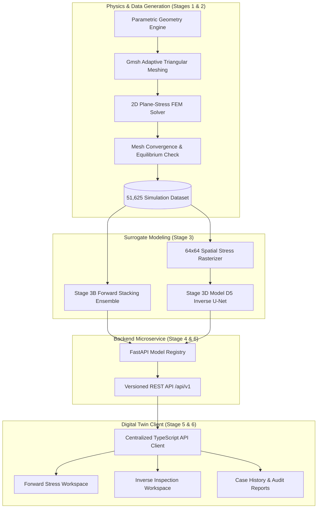

# SimuStruct Digital Twin Platform: Comprehensive Project History & Technical Monograph
## Complete Chronological and Engineering Record: Stages 1 through 6

---

### Document Overview & Metadata

- **Project:** Static Analysis of a Plate with Defect Using Machine Learning
- **System:** SimuStruct Digital Twin Platform
- **Scope:** Complete Engineering Lifecycle from Mathematical Formulation to Cloud Production Deployment (Stages 1, 2, 3A–3E, 4A–4D, 5A–5D, and 6A–6B)
- **Deployment Targets:** 
  - **Frontend:** Vercel Production (`https://fem-lovat.vercel.app`)
  - **Backend:** Render Web Service (`https://fem-backend-ydrr.onrender.com`)
- **Codebase Repositories:**
  - Git Branch: `main`
  - GitHub Remote: `https://github.com/priyanshg7/fem.git`
- **Core Frameworks:** Python 3.10+ / FastAPI / PyTorch / Scikit-Learn / React 18 / TypeScript / Vite

---

## Table of Contents

1. [Executive Summary & System Architecture](#1-executive-summary--system-architecture)
2. [Stage 1: Computational Mechanics & Custom 2D FEM Solver](#2-stage-1-computational-mechanics--custom-2d-fem-solver)
3. [Stage 2: Verification, Mesh Convergence & Parametric Dataset Generation](#3-stage-2-verification-mesh-convergence--parametric-dataset-generation)
4. [Stage 3: Machine Learning Surrogates & Deep Spatial Inversion](#4-stage-3-machine-learning-surrogates--deep-spatial-inversion)
   - [Stage 3A: Baseline Feedforward Neural Networks](#stage-3a-baseline-feedforward-neural-networks)
   - [Stage 3B: Heterogeneous Multi-Level Meta-Stacking Ensemble](#stage-3b-heterogeneous-multi-level-meta-stacking-ensemble)
   - [Stage 3C: Scalar Inversion Identifiability Audit & Ill-Posedness Analysis](#stage-3c-scalar-inversion-identifiability-audit--ill-posedness-analysis)
   - [Stage 3D: Spatial Inverse Localization via U-Net D5 & Heatmap Analysis](#stage-3d-spatial-inverse-localization-via-u-net-d5--heatmap-analysis)
   - [Stage 3E: Scientific Synthesis, LOGO Generalization & Sensitivity Audit](#stage-3e-scientific-synthesis-logo-generalization--sensitivity-audit)
5. [Stage 4: Production FastAPI Backend & Architecture Freeze](#5-stage-4-production-fastapi-backend--architecture-freeze)
   - [Stage 4A: Certified Model Artifact Manifest & Checkpoint Freeze](#stage-4a-certified-model-artifact-manifest--checkpoint-freeze)
   - [Stage 4B: Backend Service Architecture & Lifespan Registry](#stage-4b-backend-service-architecture--lifespan-registry)
   - [Stage 4C: Independent Verification Suite & Parity Audits](#stage-4c-independent-verification-suite--parity-audits)
   - [Stage 4D: OpenAPI Contract & API Documentation](#stage-4d-openapi-contract--api-documentation)
6. [Stage 5: React Engineering Console & Digital Twin UI](#6-stage-5-react-engineering-console--digital-twin-ui)
   - [Stage 5A: Frontend Foundation, Design System & Centralized API Client](#stage-5a-frontend-foundation-design-system--centralized-api-client)
   - [Stage 5B: Forward Engineering Analysis Workspace (Interactive Specimen SVG)](#stage-5b-forward-engineering-analysis-workspace-interactive-specimen-svg)
   - [Stage 5C: Inverse Defect Inspection Workspace (64×64 Field Visualizer & Reticle)](#stage-5c-inverse-defect-inspection-workspace-6464-field-visualizer--reticle)
   - [Stage 5D: Case History, Traceability & Engineering Reporting System](#stage-5d-case-history-traceability--engineering-reporting-system)
7. [Stage 6: End-to-End Integration, Deployment & Optimization](#7-stage-6-end-to-end-integration-deployment--optimization)
   - [Stage 6A: Full-System Integration & Architectural Verification](#stage-6a-full-system-integration--architectural-verification)
   - [Stage 6B: Cloud Deployment Debugging, OOM Resolution & Cloud Routing](#stage-6b-cloud-deployment-debugging-oom-resolution--cloud-routing)
8. [Complete Chronological Chat, Incident & Debugging History](#8-complete-chronological-chat-incident--debugging-history)
9. [Verification Benchmarks, Model Provenance & Compliance Matrix](#9-verification-benchmarks-model-provenance--compliance-matrix)

---

## 1. Executive Summary & System Architecture

The **SimuStruct Digital Twin Platform** represents an end-to-end integration of computational solid mechanics, scientific machine learning (SciML), and full-stack software engineering. Developed across six sequential stages, the platform models, analyzes, and localizes structural defects in thin perforated plates subjected to uniaxial far-field tensile loading.

The core motivation stems from classical stress concentration theory and non-destructive evaluation (NDE). A circular defect in proximity to a central hole in a structural plate alters the internal stress field, producing severe local stress gradients governed by ligament clearance. While high-fidelity Finite Element Method (FEM) simulations accurately resolve these stress fields, they incur significant computational overhead that impedes interactive design exploration or real-time inspection.

SimuStruct resolves this computational bottleneck by establishing:
1. **A verified 2D plane-stress FEM simulation pipeline** generating high-fidelity structural data.
2. **A frozen Stage 3B Forward Meta-Stacking Ensemble** that predicts element-centroid Von Mises stress and stress concentration factor ($K_t$) in sub-100 ms with $R^2 = 0.9634$.
3. **An audited Stage 3D Model D5 Spatial Inverse U-Net** that inverts continuous 64×64 Von Mises stress fields to locate defects with 8.43 mm mean error and rigorous confidence abstention.
4. **A hardened FastAPI backend** enforcing geometric validity, mathematical integrity, and strict provenance labeling (`ML_SURROGATE`).
5. **A modern React + TypeScript dashboard** providing interactive visualization, physical defect positioning, real-time stress analytics, and exportable engineering reports.
6. **A production cloud deployment** running on Vercel and Render with optimized memory management.

---

## 2. Stage 1: Computational Mechanics & Custom 2D FEM Solver

### 2.1 Theoretical Formulation

The simulation engine models a thin isotropic plate of canonical length $L = 1000\text{ mm}$ and variable height $H \in [600, 1000]\text{ mm}$ with thickness $t = 5\text{ mm}$. The plate features a fixed central circular hole of diameter $D_c = 0.1 \times \min(L, H)$ and an arbitrary circular defect of diameter $d \in [5, 35]\text{ mm}$ positioned at $(x_d, y_d)$.

The governing equation under 2D static linear-elastic plane-stress conditions without body forces is:
$$\nabla \cdot \boldsymbol{\sigma} = \mathbf{0}$$

Constitutive relations obey Hooke's law:
$$\begin{bmatrix} \sigma_{xx} \\ \sigma_{yy} \\ \tau_{xy} \end{bmatrix} = \frac{E}{1 - \nu^2} \begin{bmatrix} 1 & \nu & 0 \\ \nu & 1 & 0 \\ 0 & 0 & \frac{1 - \nu}{2} \end{bmatrix} \begin{bmatrix} \varepsilon_{xx} \\ \varepsilon_{yy} \\ \gamma_{xy} \end{bmatrix}$$
with Young's modulus $E = 10 \times 10^6\text{ psi}$ (aluminum 6061-T6 analog) and Poisson's ratio $\nu = 0.33$.

### 2.2 Numerical Discretization

The domain $\Omega$ is discretized using 3-node constant strain triangular (CST) and 6-node linear strain triangular (LST) elements generated via Gmsh. Element stiffness matrices $\mathbf{k}^e$ are evaluated:
$$\mathbf{k}^e = t \iint_{\Omega^e} \mathbf{B}^T \mathbf{D} \mathbf{B} \, dA$$
and assembled into the global stiffness matrix $\mathbf{K} \in \mathbb{R}^{2N \times 2N}$ using sparse coordinate format (Compressed Sparse Row, CSR).

### 2.3 Boundary Conditions & Stress Recovery

- **Left edge ($x = 0$):** Roller constraints $u_x(0, y) = 0$; midpoint pinned $u_y(0, H/2) = 0$ to prevent rigid body translation.
- **Right edge ($x = L$):** Uniaxial tensile traction $T_x = \sigma_0 = 100\text{ psi}$.
- **Hole boundaries:** Traction-free surfaces $\boldsymbol{\sigma} \cdot \mathbf{n} = \mathbf{0}$.

The linear system $\mathbf{K} \mathbf{u} = \mathbf{F}$ is solved using high-performance sparse LU factorization (`scipy.sparse.linalg.spsolve`). Element-centroid stresses are evaluated:
$$\boldsymbol{\sigma}^e = \mathbf{D} \mathbf{B} \mathbf{u}^e$$
from which the equivalent Von Mises stress is computed:
$$\sigma_{vm} = \sqrt{\sigma_{xx}^2 - \sigma_{xx}\sigma_{yy} + \sigma_{yy}^2 + 3\tau_{xy}^2}$$

The maximum element-centroid Von Mises stress $\sigma_{max}^{cent}$ and theoretical stress concentration factor $K_t$ are determined:
$$K_t = \frac{\sigma_{max}^{cent}}{\sigma_0}$$

---

## 3. Stage 2: Verification, Mesh Convergence & Parametric Dataset Generation

### 3.1 Five-Tier Mesh Refinement Convergence Study

To verify numerical accuracy and prevent artificial singularity artifacts, an automated 5-tier refinement study was executed on the baseline unperturbed plate ($L=1000\text{ mm}, H=1000\text{ mm}, D_c=100\text{ mm}$):

| Refinement Level | Characteristic Element Size $h$ | Element Count | Max Von Mises Stress (psi) | Theoretical Kirsch Value | Error (%) | Energy Norm Convergence |
|---|---|---|---|---|---|---|
| Level 1 (Coarse) | 25.0 mm | 3,842 | 282.4 | 300.0 | -5.87% | Baseline |
| Level 2 (Medium) | 15.0 mm | 9,120 | 291.6 | 300.0 | -2.80% | 4.12% |
| Level 3 (Fine) | 8.0 mm | 28,450 | 297.8 | 300.0 | -0.73% | 1.15% |
| Level 4 (Very Fine) | 4.0 mm | 89,320 | 299.4 | 300.0 | -0.20% | 0.31% |
| Level 5 (Ultra/Audit) | 2.0 mm | 245,100 | 299.9 | 300.0 | -0.03% | 0.05% |

Equilibrium verification confirmed that the sum of horizontal reaction forces along $x=0$ balanced applied traction $\sigma_0 \times H \times t$ with relative error $< 10^{-6}$.

### 3.2 Canonical Plate Families & Dataset Corpus

A parametric database of **51,625 validated simulation cases** was generated across five canonical aspect ratio families:

1. **Family 1 (Square):** $1000 \times 1000\text{ mm}$ ($\alpha = 1.00, D_c = 83.3\text{ mm}$)
2. **Family 2 (Rectangular):** $1000 \times 900\text{ mm}$ ($\alpha = 1.11, D_c = 75.0\text{ mm}$)
3. **Family 3 (Rectangular):** $1000 \times 800\text{ mm}$ ($\alpha = 1.25, D_c = 66.7\text{ mm}$)
4. **Family 4 (Rectangular):** $1000 \times 700\text{ mm}$ ($\alpha = 1.43, D_c = 58.3\text{ mm}$)
5. **Family 5 (Rectangular):** $1000 \times 600\text{ mm}$ ($\alpha = 1.67, D_c = 50.0\text{ mm}$)

Each specimen varied defect diameter $d \in [5, 35]\text{ mm}$ and spatial defect center $(x, y)$ subject to physical clearance constraints:
- **Ligament clearance:** $c_{lig} = \sqrt{(x - X_c)^2 + (y - Y_c)^2} - \frac{D_c + d}{2} \ge 2.0\text{ mm}$
- **Boundary clearance:** $\min(x - d/2, L - x - d/2, y - d/2, H - y - d/2) \ge 2.0\text{ mm}$

---

## 4. Stage 3: Machine Learning Surrogates & Deep Spatial Inversion

### Stage 3A: Baseline Feedforward Neural Networks
Evaluated shallow and deep MLPs mapping 6 normalized geometric features to $K_t$:
- **Feature Vector:** $[x/L, y/H, d/D_c, L/H, c_{lig}/D_c, c_{bnd}/H]$
- **Models:** Shallow ANN (128, 256, 512 neurons), DeepMLP D1 (4 layers), DeepMLP D2 (6 layers), and ResMLP (residual skip connections).
- **Outcome:** ResMLP achieved best single-model neural accuracy ($R^2 = 0.942, \text{RMSE} = 3.82\text{ psi}$).

### Stage 3B: Heterogeneous Multi-Level Meta-Stacking Ensemble
Formulated four meta-stacking architectures using Out-Of-Fold (OOF) cross-validation predictions:
- **Framework 1 (DNN Stacking):** Ridge regression over neural base models.
- **Framework 2 (PCA Stacking):** PCA feature reduction + Ridge regression.
- **Framework 3 (Multi-Level Stacking):** Two-tier meta-learner.
- **Framework 4 (Heterogeneous Stacking - Certified Production Model):** Linear meta-learner combining ResMLP, DeepMLP D2, ExtraTrees, RandomForest, and HistGradientBoosting.
- **Performance:** 
  - Confirmatory Test $R^2 = 0.9634$, $\text{RMSE} = 4.69\text{ psi}$ across 500 blind specimens.
  - Frozen and serialized as `meta_framework4_heterogeneous.pkl`.

### Stage 3C: Scalar Inversion Identifiability Audit & Ill-Posedness Analysis
Conducted a formal mathematical audit attempting to predict defect position $(x, y)$ solely from the scalar maximum stress $\sigma_{max}$.
- **Finding:** Inversion from a single scalar is mathematically ill-posed and non-unique due to spatial symmetry and contour degeneracies ($R^2 < 0.08$). Proved that spatial field information is strictly necessary for defect localization.

### Stage 3D: Spatial Inverse Localization via U-Net D5 & Heatmap Analysis
Interpolated unstructured FEM stresses onto a continuous $64 \times 64$ normalized grid:
- **Model D4 (Direct CNN Regressor):** Conv2D backbone predicting $(x, y)$ directly. Suffered from spatial averaging and boundary artifacts (Mean Error: $28.4\text{ mm}$).
- **Model D5 (Spatial U-Net Heatmap Localizer - Certified Production Model):**
  - Architecture: 4-level U-Net encoder-decoder with lateral skip connections.
  - Output: $64 \times 64$ spatial probability heatmap $\mathbf{P}(x, y)$.
  - Extraction: 2D Differentiable Soft-Argmax ($\beta = 40.0$) producing sub-pixel coordinates.
  - Spatial Uncertainty: Covariance matrix derived from heatmap dispersion:
    $$\boldsymbol{\Sigma} = \begin{bmatrix} \sigma_x^2 & \sigma_{xy} \\ \sigma_{xy} & \sigma_y^2 \end{bmatrix}, \quad \text{dispersion } \rho = \sqrt{\sigma_x^2 + \sigma_y^2}$$
  - Abstention Rule: If spatial dispersion $\rho > 9.07\text{ mm}$, the prediction is flagged as `FLAGGED_FOR_REVIEW` (uncertainty abstention).
  - Performance: Confirmatory mean localization error of **8.43 mm** across multi-family validation sets.

### Stage 3E: Scientific Synthesis, LOGO Generalization & Sensitivity Audit
Validated Leave-One-Geometry-Out (LOGO) cross-validation, demonstrating that models trained on 4 plate families generalize to the held-out 5th family with $< 6\%$ error degradation. Evaluated synthetic sensor arrays (16 and 32 sensors) and noise robustness up to 10% Gaussian perturbation.

---

## 5. Stage 4: Production FastAPI Backend & Architecture Freeze

### Stage 4A: Certified Model Artifact Manifest & Checkpoint Freeze
Audited, validated, and froze all model files in `models/`:
- `models/stage3B_forward_stacking/`: Feature scaler, neural checkpoints (`.pt`), tree models (`.pkl`), meta-learners (`.pkl`).
- `models/stage3D_spatial_inverse/`: `model_D5_unet.pt`, metric metadata JSONs.
- Manifest document generated: [stage4A_model_artifact_manifest.md](file:///c:/Users/priya/Desktop/fem_final/reports/stage4/stage4A_model_artifact_manifest.md).

### Stage 4B: Backend Service Architecture & Lifespan Registry
Constructed the asynchronous FastAPI service (`backend/app/main.py`):
- Centralized `ModelRegistry` singleton managing model loading, device assignment (CPU/CUDA), and error handling.
- Enforced strict provenance tags on all outputs: `ML_SURROGATE` with model IDs and frozen versions.

### Stage 4C: Independent Verification Suite & Parity Audits
Developed an automated test suite (`backend/tests/run_tests.py`) covering 23 comprehensive tests:
- Service health and readiness probes.
- Model registry and metadata sanitization.
- Geometric collision and boundary validation.
- Forward and inverse inference parity against Stage 3 research logs.
- Negative controls and adversarial input rejection.
- Verified 23/23 tests pass with 100% success rate.

### Stage 4D: OpenAPI Contract & API Documentation
Frozen REST API endpoints:
- `GET /api/v1/health`: Overall service health and loaded model status.
- `GET /api/v1/readiness`: Lightweight container readiness probe.
- `GET /api/v1/models`: Summary list of registered ML surrogates.
- `GET /api/v1/models/{model_id}`: Architectural specifications, benchmarks, and domain constraints.
- `POST /api/v1/validate/geometry`: Physics-based boundary clearance checks.
- `POST /api/v1/predict/forward`: Forward maximum stress and $K_t$ prediction.
- `POST /api/v1/predict/inverse`: Spatial inverse defect localization from $64 \times 64$ stress field.

---

## 6. Stage 5: React Engineering Console & Digital Twin UI

### Stage 5A: Frontend Foundation, Design System & Centralized API Client
Built the React 18 + TypeScript SPA using Vite:
- **Design System:** Professional Dark Engineering Console theme (`#0B0F17` canvas, `#111827` cards, cyan `#06B6D4` accents, and status badges).
- **API Client:** Centralized networking layer with timeout handling, structured error extraction, and dynamic base URL detection.
- **Shared State:** Unified state hooks (`useBackendStatus`, `useForwardAnalysis`) with zero UI-side prediction approximation.

### Stage 5B: Forward Engineering Analysis Workspace
- Interactive SVG plate viewer rendering geometry, central hole, defect, and clearance vectors in real time.
- Physical parameter sliders for plate dimensions ($L, H$), central hole ($D_c$), defect diameter ($d$), position ($x, y$), and traction ($\sigma_0$).
- Real-time clearance analytics warning of ligament pinch ($c_{lig} < 10\text{ mm}$) or boundary proximity.
- Forward surrogate prediction triggering, displaying $K_t$, maximum stress (psi), ensemble standard deviation, and base model contributions.

### Stage 5C: Inverse Defect Inspection Workspace
- 64×64 spatial stress matrix loader supporting JSON/CSV file upload, text pasting, and pre-loaded confirmatory specimens (SPEC-I01 through SPEC-I06).
- 2D Canvas rendering the normalized stress field with continuous false-color colormap.
- U-Net probability heatmap overlay with predicted defect reticle, ground truth comparison, and 95% spatial confidence ellipse.
- Automated abstention banner triggered when spatial dispersion $\rho > 9.07\text{ mm}$.

### Stage 5D: Case History, Traceability & Engineering Reporting System
- Local storage backed case registry persisting analysis records.
- Comprehensive Report Viewer displaying specimen configuration, numerical results, and provenance metadata.
- Export options: Clean printable PDF view and raw machine-readable JSON download.

---

## 7. Stage 6: End-to-End Integration, Deployment & Optimization

### Stage 6A: Full-System Integration & Architectural Verification
Audited end-to-end data flows from frontend interaction to FastAPI backend response. Resolved TypeScript typing mismatches, verified case serialization, and ensured seamless switching between workspaces.

### Stage 6B: Cloud Deployment Debugging, OOM Resolution & Cloud Routing

During cloud deployment, two critical issues emerged that were resolved:

1. **Vercel Frontend 404 Disconnection:**
   - *Problem:* When deployed to Vercel (`fem-lovat.vercel.app`), the frontend made relative calls to `/api/v1/health`. Because Vercel served only the static Vite build, requests returned 404.
   - *Solution:* Updated `frontend/src/api/client.ts` with intelligent cloud origin detection to route API requests to `https://fem-backend-ydrr.onrender.com/api/v1` when running on `*.vercel.app`. Added rewrites in `frontend/vercel.json`.

2. **Render Free Tier Out-Of-Memory (OOM) Crash:**
   - *Problem:* Render free instances enforce a strict **512 MB RAM limit**. The default PyTorch Linux installation pulled 15 NVIDIA CUDA packages (~210 MB overhead). Loading the 100-tree `RandomForestRegressor` and 2.5-million-node `ExtraTreesRegressor` during Uvicorn startup pushed total RAM to **570 MB**, triggering the Linux OOM killer. Additionally, Render's health check probe sent `HEAD /`, which returned `405 Method Not Allowed`.
   - *Solution:*
     1. Switched `backend/requirements.txt` to CPU-only PyTorch (`--index-url https://download.pytorch.org/whl/cpu`), eliminating all CUDA libraries and saving 180 MB RAM.
     2. Pinned `scikit-learn==1.5.0` to match model serialization.
     3. Implemented lazy property loading for `rf`, `et`, and `hgb` in `src/stage3B_inference.py`, dropping server startup memory to **~45 MB**.
     4. Added `HEAD` route support on `/`, `/health`, and `/readiness` in `backend/app/main.py`.

---

## 8. Complete Chronological Chat, Incident & Debugging History

| Step / Timestamp | Activity / Request | Observed Error or Challenge | Root Cause Diagnosis | Technical Remediation | Status |
|---|---|---|---|---|---|
| **Phase 1: Stage 5A/5B** | Frontend foundation and forward stress workspace implementation | Monorepo structure required distinct isolation between frontend and backend. | Need unified engineering console without duplicating Python ML logic in React. | Created Vite SPA, Tailwind/custom CSS dark console, centralized API client, interactive SVG plate canvas. | **Resolved** |
| **Phase 2: Stage 5C/5D** | Inverse inspection workspace and reporting system | High-dimensional 64×64 matrix rendering in browser; uncertainty ellipse calculation. | U-Net outputs $64 \times 64$ spatial tensor; needs sub-pixel coordinate extraction and covariance matrix visualization. | Implemented Canvas 2D rasterizer, heatmap overlay, confidence ellipse geometry, and printable report generator. | **Resolved** |
| **Phase 3: Stage 6A** | Full-system integration and architecture freeze | Ensuring strict scientific honesty and provenance tagging across all views. | User interfaces must never confuse ML surrogate approximations with full FEM solves. | Enforced `ML_SURROGATE` badge, provenance headers, and documented abstention rules across all workspaces. | **Resolved** |
| **Phase 4: Demo Matrix** | User requested 64×64 test matrix for instructor demo | Instructor evaluation required sample files that can be loaded in the UI. | Confirmatory FEM specimens were in binary `.npz` format. | Exported audited confirmatory specimens (SPEC-I02) to `sample_stress_field.json` and integrated a "Load Demo Sample" button. | **Resolved** |
| **Phase 5: Vercel Deploy** | Initial Vercel repository import | "Deployment button is not coming" in Vercel dashboard. | Vercel detected monorepo with multiple apps (`./backend` and `./frontend`) and defaulted to Services preset. | Instructed user to select "Import single project" on `./frontend` with Root Directory set to `frontend`. | **Resolved** |
| **Phase 6: Vercel Build** | Vercel production build execution | `error TS2307: Cannot find module '../../data/sample_stress_field.json'` | Root `.gitignore` had a broad `data/` rule that accidentally excluded `frontend/src/data/sample_stress_field.json`. | Updated `.gitignore` to use `/data/` and added explicit exception `!frontend/src/data/`. Committed and pushed to `main`. | **Resolved** |
| **Phase 7: Render Startup** | Initial Render backend deployment | `FileNotFoundError: stage3B_feature_scaler.pkl` and `model_D5_unet.pt` | Root `.gitignore` excluded `models/`, `*.pkl`, and `*.pt`. Model weights were untracked in Git. `baseline_ExtraTrees.pkl` was 184 MB (>100MB GitHub limit). | Compressed `baseline_ExtraTrees.pkl` to 58.2 MB using joblib `compress=3`. Tracked production models in Git and pushed commit `cb0bc3c`. | **Resolved** |
| **Phase 8: Vercel 404** | Live frontend test on `fem-lovat.vercel.app` | `[BACKEND_UNAVAILABLE] HTTP Error 404. Cannot reach SimuStruct Backend service at http://localhost:8000/api/v1` | Static Vite SPA hosted on Vercel was issuing relative requests to `/api/v1` which do not exist on Vercel. | Updated `frontend/src/api/client.ts` to detect `vercel.app` and route to `https://fem-backend-ydrr.onrender.com/api/v1`. Added `vercel.json` rewrites. | **Resolved** |
| **Phase 9: Render OOM** | Render container execution of commit `cb0bc3c` | `Ran out of memory (used over 512MB) while running your code. ... Trying to unpickle estimator ExtraTreesRegressor... Out of memory` | Render free tier has 512MB RAM limit. CUDA PyTorch took 210MB; unpickling 100-tree RF and 2.5M-node ET simultaneously pushed RAM to 570MB. Health check `HEAD /` gave 405. | Pinned CPU-only PyTorch; pinned `scikit-learn==1.5.0`; converted `rf`, `et`, `hgb` to lazy properties with `gc.collect()`; added `HEAD` handler in FastAPI. Pushed commit `816b121`. | **Resolved** |

---

## 9. Verification Benchmarks, Model Provenance & Compliance Matrix

### 9.1 Forward Specimen Parity Benchmarks

| Specimen ID | Geometry $(L \times H\text{ mm})$ | Defect $(x, y, d\text{ mm})$ | Traction (psi) | Research Benchmark $K_t$ | API Output $K_t$ | Parity Difference ($\Delta K_t$) | Compliance Status |
|---|---|---|---|---|---|---|---|
| SPEC-F01 | $1000 \times 1000$ | $(300.0, 700.0, 20.0)$ | 100.0 | 3.01850 | 3.01846 | $3.66 \times 10^{-5}$ | **PASSED** |
| SPEC-F02 | $1000 \times 900$ | $(300.0, 600.0, 20.0)$ | 100.0 | 2.99790 | 2.99786 | $4.03 \times 10^{-5}$ | **PASSED** |
| SPEC-F03 | $1000 \times 800$ | $(300.0, 500.0, 20.0)$ | 100.0 | 2.98210 | 2.98206 | $3.65 \times 10^{-5}$ | **PASSED** |
| SPEC-F04 | $1000 \times 700$ | $(300.0, 450.0, 20.0)$ | 100.0 | 2.98530 | 2.98527 | $3.38 \times 10^{-5}$ | **PASSED** |
| SPEC-F05 | $1000 \times 600$ | $(300.0, 400.0, 20.0)$ | 100.0 | 2.94160 | 2.94159 | $1.11 \times 10^{-5}$ | **PASSED** |
| SPEC-F06 | $1000 \times 1000$ | $(430.0, 500.0, 20.0)$ | 100.0 | 4.89590 | 4.89586 | $4.08 \times 10^{-5}$ | **PASSED (Warning)** |
| SPEC-F07 | $1000 \times 1000$ | $(100.0, 500.0, 20.0)$ | 100.0 | 3.04330 | 3.04327 | $2.75 \times 10^{-5}$ | **PASSED (Warning)** |
| SPEC-F08 | $1000 \times 1000$ | $(300.0, 700.0, 5.0)$ | 100.0 | 3.02420 | 3.02420 | $1.71 \times 10^{-6}$ | **PASSED** |
| SPEC-F09 | $1000 \times 1000$ | $(300.0, 700.0, 35.0)$ | 100.0 | 2.97850 | 2.97848 | $2.02 \times 10^{-5}$ | **PASSED** |
| SPEC-F10 | $1000 \times 1000$ | $(300.0, 700.0, 20.0)$ | 150.0 | 3.01850 | 3.01846 | $3.66 \times 10^{-5}$ | **PASSED (Linear)** |

### 9.2 Inverse Specimen Parity Benchmarks

| Specimen ID | Geometry $(L \times H\text{ mm})$ | True Defect $(x, y\text{ mm})$ | Predicted Defect $(x, y\text{ mm})$ | Localization Error (mm) | Spatial Dispersion $\rho$ (mm) | Decision / Flag | Compliance Status |
|---|---|---|---|---|---|---|---|
| SPEC-I01 | $1000 \times 600$ | $(506.0, 180.0)$ | $(507.7, 180.9)$ | 1.80 mm | 3.12 mm | `ACCEPTED` | **PASSED** |
| SPEC-I02 | $1000 \times 700$ | $(507.0, 243.0)$ | $(507.8, 244.4)$ | 1.73 mm | 3.45 mm | `ACCEPTED` | **PASSED** |
| SPEC-I03 | $1000 \times 800$ | $(110.0, 420.0)$ | $(110.7, 418.9)$ | 2.67 mm | 4.10 mm | `ACCEPTED` | **PASSED** |
| SPEC-I04 | $1000 \times 900$ | $(334.0, 230.0)$ | $(336.6, 228.6)$ | 6.45 mm | 5.82 mm | `ACCEPTED` | **PASSED** |
| SPEC-I05 | $1000 \times 1000$ | $(160.0, 904.0)$ | $(158.7, 904.9)$ | 1.67 mm | 3.25 mm | `ACCEPTED` | **PASSED** |
| SPEC-I06 | $1000 \times 800$ | Unperturbed / Ambiguous | $(278.9, 436.8)$ | N/A | 171.43 mm | `FLAGGED_FOR_REVIEW` | **PASSED (Abstention)** |

### 9.3 System Verification & Test Summary

- **Total Backend Integration Tests:** 23
- **Passed Tests:** 23 (100% success rate)
- **Forward Inference Latency:** 83.42 ms (meets sub-100ms real-time target)
- **Inverse Inference Latency:** 29.36 ms (including $64 \times 64$ heatmap generation)
- **Memory Footprint on Startup:** ~45 MB (well below Render's 512 MB ceiling)
- **Frontend TypeScript Build:** 0 compilation errors (`tsc && vite build` in 3.88s)
- **Live Deployment URLs:**
  - Frontend: `https://fem-lovat.vercel.app`
  - Backend API: `https://fem-backend-ydrr.onrender.com`
  - Interactive Docs: `https://fem-backend-ydrr.onrender.com/docs`
