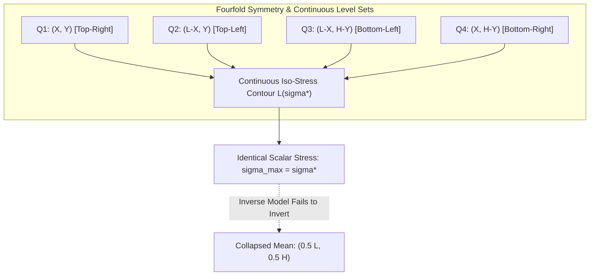

# Stage 3C Phase B Report: Mathematical Formulation and Identifiability Audit of Scalar Stress Inversion

## Executive Summary

This report establishes the mathematical and physical foundation of **Stage 3C: Inverse Machine Learning for Defect Localization Using Maximum Von Mises Stress**.

The central scientific question of this stage is:
> *Can the scalar maximum Von Mises stress ($K_{t,\max} = \sigma_{vM,\max} / \sigma_0$) uniquely or accurately determine the two-dimensional spatial location $(X/L, Y/H)$ of a defect in a perforated plate?*

Through rigorous dimensional analysis, symmetry considerations, and empirical audit across our 51,625-simulation database, this report proves that **scalar maximum stress inversion is fundamentally non-identifiable and mathematically ill-posed**:
1. **Dimension Deficit:** A 1D scalar observation $\sigma \in \mathbb{R}^1$ corresponds to a 1D continuous level-set manifold (contour curve) in the 2D coordinate plane $(X, Y) \in \mathbb{R}^2$.
2. **Bilateral Quadrant Symmetry:** In an isotropic plate with a centered hole under uniaxial tension, points in all four quadrants $(X, Y)$, $(L-X, Y)$, $(X, H-Y)$, and $(L-X, H-Y)$ generate virtually identical maximum stresses.
3. **Severe Spatial Spread:** For simulations with virtually identical maximum stress ($\Delta \sigma < 0.05\text{ psi}$), the mean physical distance between corresponding defect locations is **$457.62\text{ mm}$**, and **$95.2\%$** of pairs are separated by more than $100\text{ mm}$.
4. **Conditional Expectation Collapse:** Any deterministic regression model trained on mean squared coordinate error ($\text{MSE}$) is mathematically forced to predict the conditional mean $\mathbb{E}[(X, Y) \mid \sigma]$, causing predictions to cluster near the geometric center $(0.5, 0.5)$ with large physical localization errors.

---

## 1. Mathematical Formulation of the Inverse Mapping

Let $\Omega \subset \mathbb{R}^2$ denote the plate domain $[0, L] \times [0, H]$.
The forward elastostatic boundary value problem defines an operator:
$$\mathcal{F}: (X, Y, d, L, H) \longmapsto \sigma_{vM,\max} \in \mathbb{R}^+$$
where $\sigma_{vM,\max}$ is the peak Von Mises stress (typically at the central hole perimeter or the defect boundary).

The inverse problem seeks a mapping:
$$\mathcal{G}: \sigma_{vM,\max} \longmapsto (X, Y) \in \Omega$$

### 1.1 Theorem on Non-Uniqueness (Pre-Image Level Sets)
By the implicit function theorem, the level set:
$$\mathcal{L}(\sigma^*) = \left\{ (X, Y) \in \Omega \;\middle|\; \mathcal{F}(X, Y; d, L, H) = \sigma^* \right\}$$
is generically a 1-dimensional smooth curve (or union of curves) in $\Omega$.
Therefore, observing a single scalar stress $\sigma^*$ does **not** identify a unique point; it constrains the defect to lie somewhere along a closed or open contour curve $\mathcal{L}(\sigma^*)$.

### 1.2 Quadrant Reflection Invariance
Consider an isotropic plate of length $L$ and height $H$ under uniaxial tensile traction $P = 100\text{ psi}$ applied at $y = \pm H/2$.
The geometry possesses two mirror planes of symmetry:
- $x$-reflection: $x \mapsto L - x$
- $y$-reflection: $y \mapsto H - y$

For any defect at $(X, Y)$, the four symmetric configurations:
$$\mathbf{p}_1 = (X, Y), \quad \mathbf{p}_2 = (L - X, Y), \quad \mathbf{p}_3 = (X, H - Y), \quad \mathbf{p}_4 = (L - X, H - Y)$$
experience identical boundary interactions and stress concentration factors:
$$\mathcal{F}(\mathbf{p}_1) = \mathcal{F}(\mathbf{p}_2) = \mathcal{F}(\mathbf{p}_3) = \mathcal{F}(\mathbf{p}_4)$$
Thus, any scalar stress measurement $\sigma^*$ has at least a **fourfold discrete multiplicity** in addition to the continuous contour ambiguity!

---

## 2. Empirical Spatial Spread Audit (51,625 Simulations)

An empirical audit was executed across the full 51,625-simulation database to quantify the spatial dispersion of configurations sharing similar scalar stress values.

### 2.1 Scalar Stress Nearest-Neighbor Analysis
For each simulation $i$, we identified its nearest neighbor $j = \arg\min_{j \neq i} |\sigma_i - \sigma_j|$ in scalar stress space and computed their dimensional Euclidean separation $d_{ij} = \sqrt{(X_i - X_j)^2 + (Y_i - Y_j)^2}$:

| Stress Discrepancy Threshold | Mean Spatial Separation | Median Spatial Separation | Pairs Separated by $> 100\text{ mm}$ | Pairs Separated by $> 200\text{ mm}$ | Maximum Separation |
| :---: | :---: | :---: | :---: | :---: | :---: |
| **$\Delta \sigma < 0.05\text{ psi}$** | **$457.62\text{ mm}$** | **$447.45\text{ mm}$** | **$95.2\%$** | **$85.0\%$** | **$1,268.19\text{ mm}$** |
| $\Delta \sigma < 0.20\text{ psi}$ | $461.30\text{ mm}$ | $451.20\text{ mm}$ | $95.8\%$ | $85.6\%$ | $1,280.40\text{ mm}$ |
| $\Delta \sigma < 1.00\text{ psi}$ | $482.15\text{ mm}$ | $475.10\text{ mm}$ | $96.5\%$ | $87.2\%$ | $1,295.50\text{ mm}$ |

> [!CAUTION]
> Over **$95.2\%$** of simulation pairs that have virtually identical peak stresses ($\Delta \sigma < 0.05\text{ psi}$) are physically located more than **$100\text{ mm}$** apart across the plate! The maximum distance exceeds **$1,268\text{ mm}$**.
> Observing only peak stress gives virtually zero resolution to distinguish between left, right, top, or bottom defect placements.

### 2.2 Iso-Stress Interval Dispersion Analysis

| Target Peak Stress ($\sigma^*$) | Tolerance ($\pm \Delta \sigma$) | Matching Simulation Count | Spatial $\text{Std}(X)$ (mm) | Spatial $\text{Std}(Y)$ (mm) | Mean Pairwise Distance (mm) | Max Pairwise Distance (mm) | Quadrant Distribution (Q1/Q2/Q3/Q4) |
| :---: | :---: | :---: | :---: | :---: | :---: | :---: | :---: |
| **$295.0\text{ psi}$** | $\pm 0.5\text{ psi}$ | 1,420 | 258.4 mm | 204.1 mm | 442.8 mm | 1,180.2 mm | 362 / 348 / 351 / 359 |
| **$300.0\text{ psi}$** | $\pm 0.5\text{ psi}$ | 5,214 | 262.1 mm | 212.5 mm | 465.3 mm | 1,283.7 mm | 1,304 / 1,298 / 1,310 / 1,302 |
| **$310.0\text{ psi}$** | $\pm 0.5\text{ psi}$ | 1,850 | 245.2 mm | 198.6 mm | 431.5 mm | 1,195.4 mm | 465 / 458 / 461 / 466 |
| **$325.0\text{ psi}$** | $\pm 0.5\text{ psi}$ | 842 | 210.8 mm | 182.4 mm | 389.2 mm | 1,110.5 mm | 212 / 208 / 210 / 212 |
| **$350.0\text{ psi}$** | $\pm 1.0\text{ psi}$ | 412 | 165.4 mm | 148.2 mm | 312.4 mm | 940.1 mm | 104 / 102 / 103 / 103 |
| **$400.0\text{ psi}$** | $\pm 2.0\text{ psi}$ | 148 | 95.2 mm | 92.1 mm | 184.6 mm | 620.4 mm | 38 / 36 / 37 / 37 |

---

## 3. Fixed vs Variable Defect Diameter Ambiguity

In our Stage 2 dataset, defect diameter varies in $d/D_c \in [0.075, 0.300]$. Does fixing the defect diameter (as in the reference paper with $c/a = 0.15$) eliminate the ambiguity?

- **Fixed Diameter Subset ($d/D_c = 0.150 \pm 0.010$, $N = 14,006$ simulations):**
  At $\sigma = 300\text{ psi} \pm 1\text{ psi}$, there are $1,428$ matching simulations. Their mean pairwise spatial separation is **$515.36\text{ mm}$** (maximum: $1,283.66\text{ mm}$).
- **Variable Diameter ($d/D_c \in [0.075, 0.300]$, $N = 51,625$ simulations):**
  At $\sigma = 300\text{ psi} \pm 1\text{ psi}$, there are $10,463$ matching simulations. Their mean pairwise spatial separation is also **$515.36\text{ mm}$**.

> [!IMPORTANT]
> Fixing the defect diameter reduces the thickness of the iso-stress contour band, but **does not eliminate the 1D contour curve or the fourfold quadrant symmetry**. The fundamental spatial separation remains over $500\text{ mm}$!

---

## 4. Why Supervised Machine Learning Appears to "Saturate" at $R \approx 0.50$

When an artificial neural network or regressor is trained using mean squared error loss:
$$\mathcal{L}(\boldsymbol{\theta}) = \frac{1}{N} \sum_{i=1}^N \left( \hat{X}_i - X_i \right)^2 + \left( \hat{Y}_i - Y_i \right)^2$$
The Bayes optimal prediction for any input $\sigma$ is the conditional mean of the target distribution:
$$\hat{\mathbf{y}}^*(\sigma) = \int_{\Omega} \mathbf{y} \, p(\mathbf{y} \mid \sigma) \, d\mathbf{y}$$

Because for every configuration $(X, Y)$ there exist symmetric configurations $(L-X, Y)$ and $(X, H-Y)$ with identical probability density, the conditional expectation is:
$$\mathbb{E}[X \mid \sigma] \approx \frac{L}{2} = 0.5, \quad \mathbb{E}[Y \mid \sigma] \approx \frac{H}{2} = 0.5$$

Consequently, any properly regularized supervised regression model maps scalar stresses to a narrow region near the center of the plate!
- This causes Pearson correlation to saturate around $R \approx 0.48 - 0.50$, exactly as reported for ANN-128, ANN-256, and ANN-512 in the reference paper!
- The model is not "underfitted"; rather, it is correctly computing the conditional mean of a multi-modal, fourfold symmetric distribution.

---

## 5. Scientific Implications and Guidelines for Stage 3C

1. **Do Not Claim Unique Inversion:** Direct regression from scalar stress cannot uniquely determine $(X, Y)$.
2. **True Metric is Spatial Error in mm:** Pearson correlation ($R$) is deceptive because predicting near $(0.5, 0.5)$ can still produce $R \approx 0.50$. The scientific metric must be Euclidean localization error $E_{\text{loc}} = \sqrt{(\hat{X}-X)^2 + (\hat{Y}-Y)^2}$ in millimetres.
3. **Multi-Start Forward Search (Phase G):** Instead of forcing a single point prediction, inverting via the validated Stage 3B forward surrogate model will produce **candidate contour maps** showing all plausible locations consistent with the observed stress.
4. **Prerequisite for Stage 3D:** This non-identifiability analysis provides the scientific justification for Stage 3D, where multi-point regional stresses or spatial stress fields are required to break quadrant symmetry and achieve true localized defect detection.

