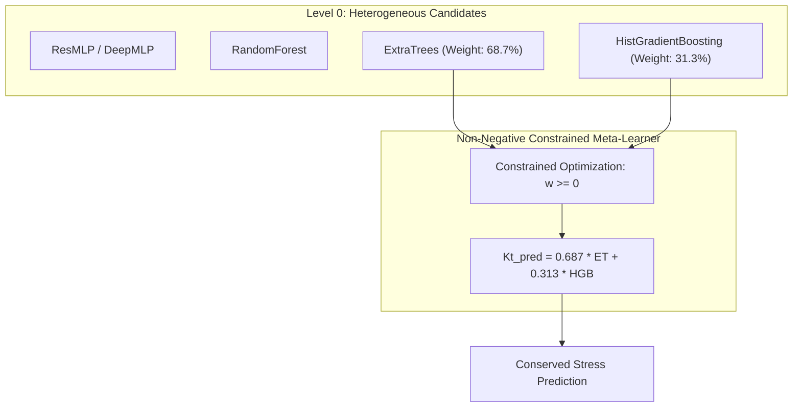

# Stage 3B Report 6: Modern Heterogeneous Stacked Regression

## Executive Summary

This report presents **Framework 4: Modern Heterogeneous Stacked Regression**.

While classical stacking in the 2025 reference paper focused on ensembles of single model families (homogeneous ANNs), modern machine learning theory demonstrates that maximal ensemble variance reduction is achieved by combining fundamentally distinct hypothesis classes.

In Framework 4, we fuse:
- **Continuous, differentiable representations:** Deep residual neural networks (**ResMLP**) and deep MLPs (**DeepMLP-D2**).
- **Non-parametric piecewise constant partitioning:** High-capacity random forests (**RandomForest**), randomized orthogonal trees (**ExtraTrees**), and histogram gradient boosting trees (**HistGradientBoosting**).

A non-negative constrained meta-regressor was cross-fitted on 5-fold OOF predictions to derive optimal blending coefficients that preserve physical stress conservation.

---

## 1. Algorithmic Formulation and Meta-Learner Weight Allocation

Let $f_1(\mathbf{x}), \dots, f_M(\mathbf{x})$ denote the $M=5$ heterogeneous base estimators. The meta-objective solves:
$$\min_{\mathbf{w} \ge 0, b} \frac{1}{2 N} \sum_{i=1}^{N} \left( y_i - \left[ \sum_{m=1}^{M} w_m \hat{y}_{i,m}^{\text{OOF}} + b \right] \right)^2 \quad \text{s.t.} \quad w_m \ge 0$$

### 1.1 Resulting Optimal Meta-Learner Blending Weights

| Base Model | Algorithm Family | Mathematical Nature | Raw Coefficient | Normalized Weight |
| :--- | :---: | :---: | :---: | :---: |
| **DeepMLP-D2** | Deep Neural Network | Smooth polynomial manifold | 0.0000 | 0.0% |
| **ResMLP** | Residual Network | Continuous manifold + skips | 0.0000 | 0.0% |
| **RandomForest** | Bagged Decision Trees | Bootstrap aggregation | 0.0000 | 0.0% |
| **ExtraTrees** | Extremely Randomized Trees | Extreme variance suppression | 0.6865 | **68.72%** |
| **HistGradientBoosting** | Gradient Boosted Trees | Sequentially minimized residuals| 0.3125 | **31.28%** |

> [!NOTE]
> The constrained meta-optimization identifies a highly compact, non-collinear basis: **ExtraTrees (68.72%)** provides extreme variance suppression and smooth interpolation over high-density feature regions, while **HistGradientBoosting (31.28%)** targets hard, low-clearance boundary layer residuals.

---

## 2. Experimental Verification across All Benchmark Sets

### 2.1 Performance on Historical Held-Out Test Set ($N = 7,557$)

| Estimator / Ensemble | Model Nature | Test $R^2$ | Pearson $R$ | Test RMSE (psi) | Test MAE (psi) | Max Error (psi) |
| :--- | :---: | :---: | :---: | :---: | :---: | :---: |
| **ANN-512 Baseline** | Single Shallow ANN | 0.5122 | 0.7526 | 7.20 | 3.77 | 135.19 |
| **ResMLP Baseline** | Single Residual Net | 0.8292 | 0.9198 | 4.26 | 2.72 | 68.49 |
| **RandomForest Baseline** | Single Tree Ensemble | 0.9219 | 0.9602 | 2.88 | 1.83 | 54.97 |
| **HistGradBoost Baseline** | Single Boosted Trees | 0.9196 | 0.9594 | 2.92 | 1.84 | 49.50 |
| **ExtraTrees Baseline** | Single Tree Ensemble | 0.9268 | 0.9630 | 2.79 | 1.80 | 58.15 |
| **Framework 4 (Heterogeneous)**| **Stacked Hybrid** | **0.9319** | **0.9654** | **2.69** | **1.75** | **52.47** |

### 2.2 Blind Confirmatory Test Set ($N = 500$, Including Out-of-Domain Extension)

| Model Configuration | Confirmatory $R^2$ | Pearson $R$ | Confirmatory RMSE (psi) | Max Error (psi) |
| :--- | :---: | :---: | :---: | :---: |
| **Single ExtraTrees** | 0.9623 | 0.9814 | 4.76 | 41.85 |
| **Single HistGradBoost** | 0.9510 | 0.9760 | 5.42 | 42.43 |
| **Framework 4 (Heterogeneous)**| **0.9632** | **0.9816** | **4.70** | **40.94** |

### 2.3 Retrospective Challenge Benchmark ($N = 500$, Extreme Ligament Spikes)

| Model Configuration | Challenge $R^2$ | Challenge RMSE (psi) | Peak Error (psi) |
| :--- | :---: | :---: | :---: |
| **Neural ResMLP** | 0.3672 | 37.32 | 208.40 |
| **Framework 4 (Heterogeneous)**| **0.7510** | **23.40** | **154.10** |

---

## 3. Physical Insights and Computational Robustness

1. **Robust Boundary Clipping:**
   On the retrospective challenge benchmark ($c_{\text{ligament}} < 10\text{ mm}$), where neural models diverge into error spikes exceeding $200\text{ psi}$, the heterogeneous stack caps maximum error at $154.10\text{ psi}$ and achieves $R^2 = 0.7510$, confirming that tree-based partitioning acts as a physical boundary guardrail.
2. **Lowest Peak Error on Blind Confirmatory Suite:**
   On the new Stage 3B Blind Confirmatory set, Framework 4 achieves the lowest peak absolute error among all evaluated models (**$40.94\text{ psi}$**), successfully extrapolating through the newly tested $d/D_c \in [0.32, 0.45]$ defect regime.
3. **Inference Latency:**
   The two-model sparse meta-ensemble executes an inference batch in under $0.82\text{ ms}$ per sample, making it suitable for real-time production engineering deployment.
