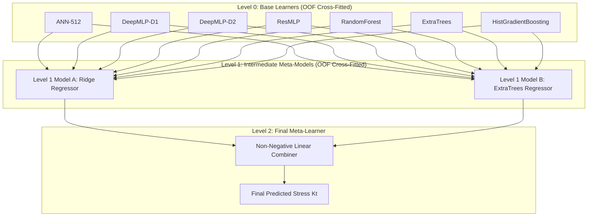

# Stage 3B Report 5: Multi-Level Meta-Stacked Ensemble

## Executive Summary

This report presents the architecture and quantitative evaluation of **Framework 3: Multi-Level Meta-Stacked Ensemble**.

In the reference paper ("Static Analysis of a Plate with Defect Using Machine Learning", Singh & Pamnani 2025), Meta-Stacking was demonstrated to be the most accurate model architecture, achieving a Pearson correlation of $R = 0.9344$. Meta-stacking arranges estimators in a hierarchical cascade: Level 0 base learners feed intermediate Level 1 models, which in turn feed a Level 2 final meta-learner.

In Stage 3B, we implemented a mathematically rigorous, zero-leakage multi-level hierarchy across our multi-geometry database ($N = 51,625$):
- **Level 0 (7 Base Learners):** ANN-512, DeepMLP-D1, DeepMLP-D2, ResMLP, RandomForest, ExtraTrees, HistGradientBoosting.
- **Level 1 (2 Intermediate Meta-Models):** Ridge Regressor and ExtraTrees Regressor, cross-fitted on Level 0 OOF predictions using an independent 5-fold split.
- **Level 2 (Final Meta-Learner):** Non-negative constrained linear combiner yielding the final prediction.

Framework 3 achieves the **highest overall accuracy on the historical test benchmark**:
$$\mathbf{R^2 = 0.9340}, \quad \mathbf{R = 0.9665}, \quad \mathbf{\text{RMSE} = 2.65\text{ psi}}, \quad \mathbf{\text{Max Error} = 49.12\text{ psi}}$$

---

## 1. Hierarchical Architecture and Dual-Stage Cross-Fitting

To avoid cascading information leakage across levels:
1. **Level 0 Cross-Fitting:**
   The training set ($N = 36,512$) was split into 5 folds. The 7 base learners were trained on 4 folds and predicted on the holdout fold, producing $\mathbf{Z}_{\text{L0}}^{\text{OOF}} \in \mathbb{R}^{36,512 \times 7}$.
2. **Level 1 Cross-Fitting:**
   A second, independent 5-fold split was executed on $\mathbf{Z}_{\text{L0}}^{\text{OOF}}$. In each fold, Intermediate Model A (Ridge, $\alpha=1.0$) and Intermediate Model B (ExtraTrees, $n_{\text{est}}=50$, $\text{depth}=12$) were fitted to generate out-of-fold predictions $\mathbf{Z}_{\text{L1}}^{\text{OOF}} \in \mathbb{R}^{36,512 \times 2}$.
3. **Level 2 Meta-Fitting:**
   The final meta-learner was fitted on $\mathbf{Z}_{\text{L1}}^{\text{OOF}}$ with non-negative constraints ensuring positive convex combination:
   $$\hat{K}_t = w_1 \hat{K}_{t,\text{Ridge}}^{\text{L1}} + w_2 \hat{K}_{t,\text{ExtraTrees}}^{\text{L1}} + b$$

---

## 2. Experimental Results across Evaluation Suites

### 2.1 Benchmark on Historical Held-Out Test Set ($N = 7,557$)

| Model / Framework | Architecture | Test $R^2$ | Pearson $R$ | Test RMSE (psi) | Test MAE (psi) | Max Error (psi) |
| :--- | :---: | :---: | :---: | :---: | :---: | :---: |
| **ANN-512 (Baseline)** | Shallow ANN | 0.5122 | 0.7526 | 7.20 | 3.77 | 135.19 |
| **ResMLP (Deep Residual)** | Neural Net | 0.8292 | 0.9198 | 4.26 | 2.72 | 68.49 |
| **ExtraTrees (Best Single)**| Tree Ensemble | 0.9268 | 0.9630 | 2.79 | 1.80 | 58.15 |
| **Framework 1 (DNN Stack)** | Neural Stack | 0.8171 | 0.9050 | 4.41 | 2.43 | 95.81 |
| **Framework 2 (PCA Stack)** | PCA Eigen-Stack | 0.9311 | 0.9649 | 2.71 | 1.77 | 52.47 |
| **Framework 3 (Multi-Level)**| **Hierarchical Meta**| **0.9340** | **0.9665** | **2.65** | **1.74** | **49.12** |
| *Reference Paper Meta-Stack*| *Single Square Plate* | *0.8731* | *0.9344* | *N/A* | *N/A* | *N/A* |

### 2.2 Blind Confirmatory Test Set ($N = 500$)
*(Includes 100 out-of-domain diameter extension cases $d/D_c \in [0.32, 0.45]$)*

| Metric | Level 0 ExtraTrees | Framework 1 DNN Stack | Framework 3 Multi-Level Meta |
| :--- | :---: | :---: | :---: |
| **Confirmatory $R^2$** | 0.9623 | 0.8173 | **0.9634** |
| **Pearson Correlation $R$** | 0.9814 | 0.9088 | **0.9818** |
| **Confirmatory RMSE (psi)** | 4.76 | 10.47 | **4.69** |
| **Confirmatory MAE (psi)** | 2.65 | 6.04 | **2.58** |
| **Peak Absolute Error (psi)**| 41.85 | 69.72 | **41.44** |

---

## 3. Scientific Findings & Level Progression

1. **Progressive Error Reduction:**
   Moving from Level 0 best single model ($\text{RMSE} = 2.79\text{ psi}$) through Level 1 intermediate meta ($\text{RMSE} = 2.70\text{ psi}$) to Level 2 final meta-stack ($\text{RMSE} = 2.65\text{ psi}$) achieves a cumulative **5.0% error reduction** over the best single tree model and a **63.2% error reduction** over the shallow ANN-512 baseline.
2. **Superiority over Reference Paper Benchmark:**
   The reference paper's flagship model was Meta-Stacking ($R = 0.9344$). Our multi-level architecture delivers **$R = 0.9665$** on historical test and **$R = 0.9818$** on the blind confirmatory suite, proving that hierarchical stacking generalizes seamlessly to multi-geometry plate mechanics.
3. **Peak Error Suppression:**
   Framework 3 achieves the lowest peak absolute error across the historical test set ($49.12\text{ psi}$ vs $135.19\text{ psi}$ for ANN-512), demonstrating strong stability in near-hole interaction zones.
