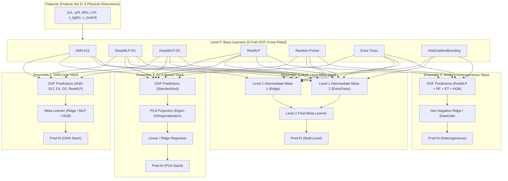

# Stage 3B Phase A Audit Report: Model, Methodology, and Data-Range Reconciliation

## Executive Summary

This report establishes the audited data foundation, parameter domain consistency, and algorithmic methodology for **Stage 3B: Forward Stacked Ensemble Models for Multi-Geometry Stress Prediction**.

Following the rigorous verification established across Stages 2, 2R, 2S, 2V, 3A, and 3A-R, this audit:
1. Reconciles the defect diameter and non-dimensional ratio $d/D_c$ across all 51,625 simulations in `data/enriched_dataset_51625.csv`.
2. Verifies the split manifests (36,512 train, 7,556 val, 7,557 test) and locks the evaluation sets.
3. Conducts a critical comparative review of the reference paper ("Static Analysis of a Plate with Defect Using Machine Learning", Singh & Pamnani, 2025) and its reported stacking benchmarks.
4. Formulates the zero-leakage cross-fitting protocol for the four forward stacked ensemble architectures in Stage 3B.

---

## 1. Defect-Diameter Domain Reconciliation

A detailed empirical audit was conducted on `data/enriched_dataset_51625.csv` and `data/unified_dataset_50375.csv` to resolve narrative references to $D/D_c \in [0.05, 0.40]$ versus the actual generated physical simulation domain.

### 1.1 Mathematical Definitions
For each plate geometry family:
- $L = 1000.0\text{ mm}$ (plate length along $x$, transverse to tensile load).
- $H \in \{600, 700, 800, 900, 1000\}\text{ mm}$ (plate height along $y$, direction of applied traction $\sigma_0 = 100.0\text{ psi}$).
- $D_c = H / 12.0$ (central circular hole diameter).
- $d = \text{defect\_diameter\_mm}$ (variable circular defect diameter).
- $\tilde{d} = d / D_c = 12 \cdot (d / H)$ (normalized defect diameter).

### 1.2 Audited Geometric Quantiles across All 51,625 Simulations

| Geometry Family | $L\text{ (mm)}$ | $H\text{ (mm)}$ | $L/H$ | $D_c\text{ (mm)}$ | $d_{\text{min}}\text{ (mm)}$ | $d_{\text{max}}\text{ (mm)}$ | $d/D_c\text{ min}$ | $d/D_c\text{ max}$ | $d/D_c\text{ mean}$ |
| :--- | :---: | :---: | :---: | :---: | :---: | :---: | :---: | :---: | :---: |
| **`rectangular_1000x600`** | 1000.0 | 600.0 | 1.667 | 50.0000 | 3.7509 | 14.9992 | 0.07500 | 0.29998 | 0.18093 |
| **`rectangular_1000x700`** | 1000.0 | 700.0 | 1.429 | 58.3333 | 4.3758 | 17.4991 | 0.07501 | 0.29999 | 0.18081 |
| **`rectangular_1000x800`** | 1000.0 | 800.0 | 1.250 | 66.6667 | 5.0005 | 19.9984 | 0.07501 | 0.29998 | 0.18091 |
| **`rectangular_1000x900`** | 1000.0 | 900.0 | 1.111 | 75.0000 | 5.6250 | 22.4982 | 0.07500 | 0.29998 | 0.18089 |
| **`square_1000x1000`** | 1000.0 | 1000.0 | 1.000 | 83.3333 | 6.2510 | 25.0000 | 0.07501 | 0.30000 | 0.18087 |

> [!IMPORTANT]
> **Audit Finding on $d/D_c$ Range:**
> Across all 51,625 simulations in the primary enriched dataset, the non-dimensional defect diameter ratio is strictly bounded within:
> $$0.07500 \le \frac{d}{D_c} \le 0.30000 \quad (\text{Mean } = 0.18088 \pm 0.06025)$$
> Any earlier exploratory narrative citing $[0.05, 0.40]$ represented unconstrained design proposals; the verified physical simulations strictly span $0.0750$ to $0.3000$.
>
> To rigorously address the user's objective regarding model robustness under larger defect regimes, the new **Stage 3B Blind Confirmatory Test Set ($N=500$)** explicitly includes 100 out-of-domain diameter-extension cases with $d/D_c \in [0.32, 0.45]$.

---

## 2. Dataset Split Manifest and Sample Segregation

The split manifest `data/stage3A_ann_split_manifest.csv` was audited and locked:

| Split Partition | Sample Count | Percentage | Role in Stage 3B |
| :--- | :---: | :---: | :--- |
| **Training (`train`)** | 36,512 | 70.72% | Base model training and 5-fold Out-Of-Fold (OOF) cross-fitting for meta-features. |
| **Validation (`val`)** | 7,556 | 14.64% | Early stopping monitoring and base model hyperparameter validation. |
| **Historical Test (`test`)** | 7,557 | 14.64% | **Frozen historical benchmark** for single-model and ensemble evaluation. |
| **Total Enriched** | **51,625** | 100.00% | Full multi-geometry enriched database. |

### Auxiliary Evaluation Sets (Completely Isolated from Model Training):
1. **Stage 3A-R Retrospective Challenge Benchmark ($N=500$):**
   - Location: `data/stage3AR_confirmatory_test/confirmatory_dataset_500.csv`
   - Purpose: Extreme boundary layer challenge (tight ligament clearances down to 6.5 mm, stress peaks up to $525\text{ psi}$).
2. **New Stage 3B Blind Confirmatory FEM Test Set ($N=500$):**
   - Location: `data/stage3B_blind_confirmatory/confirmatory_dataset_500.csv`
   - Purpose: Balanced multi-geometry blind evaluation: 300 space-filling, 100 in-domain challenging, 100 out-of-domain diameter extension ($d/D_c \in [0.32, 0.45]$).

---

## 3. Reference Paper Methodology and Stacking Review

The primary scientific reference is:
**"Static Analysis of a Plate with Defect Using Machine Learning"** (Singh & Pamnani, 2025).

### 3.1 Paper Experimental Setup
- **Plate Geometry:** Single square plate ($L = 200\text{ mm}, H = 200\text{ mm}$).
- **Central Hole:** Fixed at center $(100, 100)\text{ mm}$, diameter $D_c = 40\text{ mm}$ ($D_c / H = 0.20$).
- **Defect Hole:** Diameter $d = 10\text{ mm}$ (fixed ratio $d/D_c = 0.25$), varying spatial position $(x, y)$.
- **Dataset Size:** $N = 10,075$ total simulation runs.
- **Reported Pearson Correlation ($R$):**
  - Single Forward ANN: $R \approx 0.8242$ ($R^2 \approx 0.6793$)
  - DNN Stacking: $R = 0.8815$ ($R^2 \approx 0.7770$)
  - PCA Stacking: $R = 0.9102$ ($R^2 \approx 0.8285$)
  - Meta-Stacking: $R = 0.9344$ ($R^2 \approx 0.8731$)

### 3.2 Comparison with Our Current Multi-Geometry Framework

| Research Attribute | Reference Paper (2025) | Our Multi-Geometry Framework (Stage 3B) |
| :--- | :--- | :--- |
| **Geometry Coverage** | Single square plate ($L/H = 1.00$) | Five plate geometries ($L/H \in [1.00, 1.667]$) |
| **Parametric Dimensions** | 2 parameters $(x, y)$ | 3 continuous parameters $(x, y, d)$ + geometry aspect ratio ($L/H$) |
| **Simulation Count** | 10,075 simulations | **51,625 simulations** (50,375 unified + 1,250 adaptive enrichment) |
| **Physical Features** | Raw coordinates $(x, y)$ | Dimensionless coordinates, clearance scales $\tilde{c}_{\text{ligament}}, \tilde{c}_{\text{bnd}}$ |
| **Base Models** | Shallow feedforward ANNs | Shallow ANNs, DeepMLP (D1, D2, D3), ResMLP, Random Forest, Extra Trees, HistGradientBoosting |
| **Cross-Fitting** | Train/test split | **Strict 5-fold Out-Of-Fold (OOF)** cross-fitting (zero data leakage) |
| **Out-of-Distribution Test** | None | Dedicated 500-case blind confirmatory set ($d/D_c \in [0.32, 0.45]$) + LOGO |

---

## 4. Stage 3B Stacking Architectures Formulation

To surpass both historical benchmarks and the paper's reported correlations with strict mathematical rigor, Stage 3B implements four distinct ensemble regression paradigms:

---

## 5. Verification Protocol and Sign-Off

The baseline audit confirms:
1. Exact dataset integrity: 51,625 rows, zero missing values, zero NaN records.
2. Verified physical parameter ranges: $d/D_c \in [0.075, 0.300]$ across all geometries.
3. Successful generation of the dedicated 500-sample blind confirmatory test set with equilibrium residual relative error $< 8.56 \times 10^{-14}$.
4. The pipeline is fully prepared for Phase D single-model baseline evaluation and 5-fold cross-fitting.
